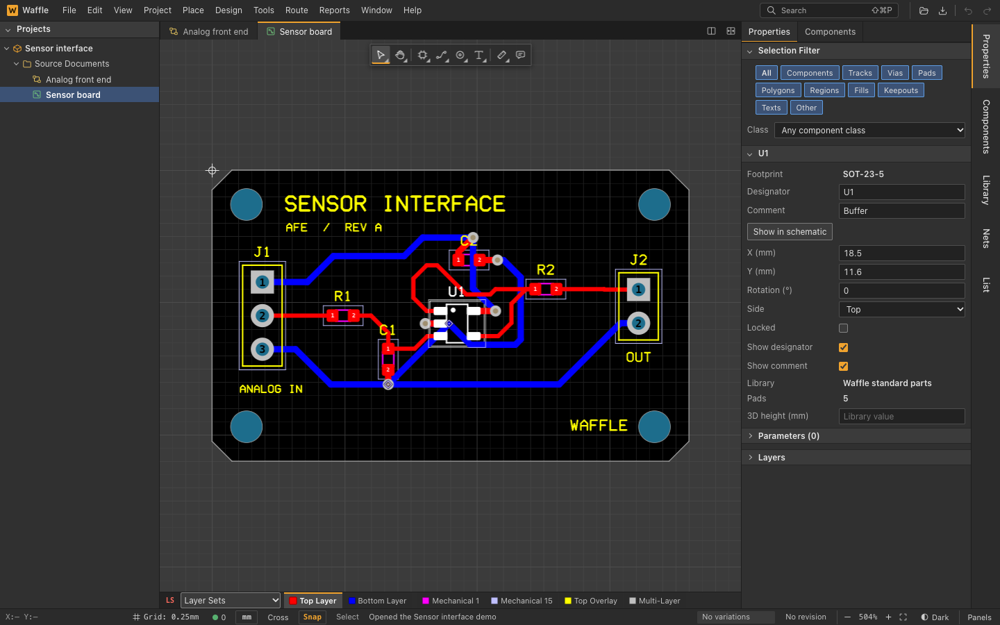
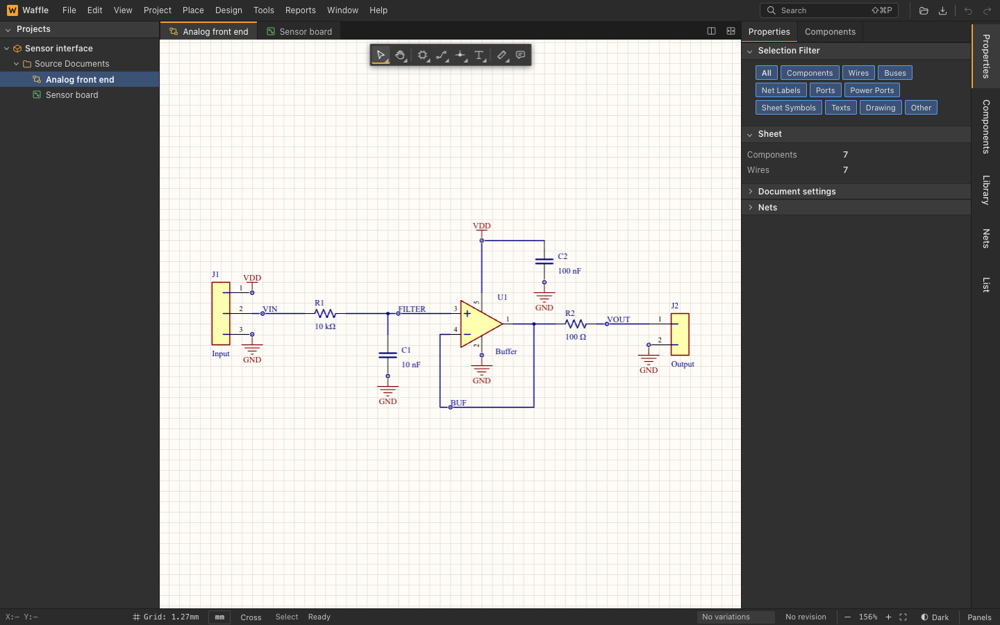
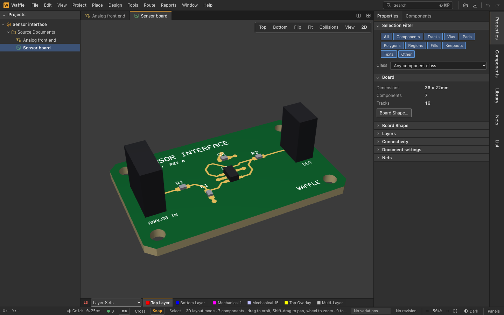
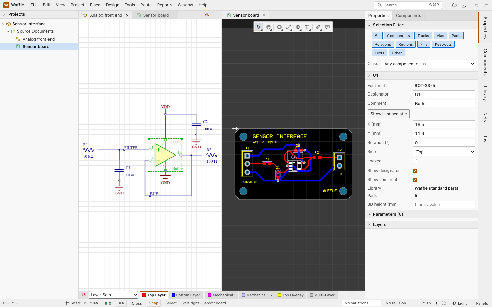
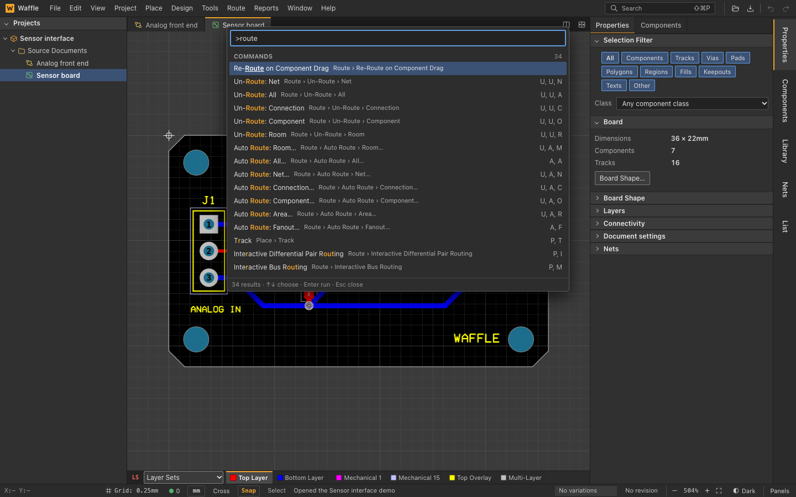

<picture>
  <source media="(prefers-color-scheme: dark)" srcset="brand/svg/waffle-lockup-eda-on-dark.svg">
  
</picture>

**A light, open schematic and PCB editor for macOS, Linux and Windows.**

Waffle is a local-first desktop EDA tool with Altium-style workflows, live design checks, a visual
history of your design, and an extension and AI interface built in from the start. It works offline,
needs no account and sends nothing anywhere unless you turn a feature on.

> **Status: 0.8 "Butter", early release.** Waffle is young. Expect rough edges and keep backups.
> Always check fabrication outputs in your manufacturer's viewer before ordering boards.



## Highlights

- **Familiar if you know Altium.** Key sequences, Active Bar, layer tabs, a rules editor, ECO and
  output jobs work the way you expect. KiCad and VS Code key presets are included.
- **Fast on big boards.** GPU drawing with a Canvas fallback, incremental redraw, live pours that
  preview while the exact fill is calculated, and online DRC that re-checks only what changed.
- **Schematic to fabrication.** Hierarchy and multichannel, variants, an interactive router with
  push-and-shove, differential pairs and length tuning, a stackup manager with rigid-flex, and
  Gerber X2, Excellon, ODB++, IPC-2581, STEP, pick-and-place, BOM and PDF outputs.
- **Bring your designs.** Open Altium, KiCad 6–9, EAGLE and EasyEDA projects. An import report
  lists what was converted and what was left out.
- **History you can see.** Visual undo history, object and file history, and side-by-side visual
  comparison of revisions, including Git. The `.waffle` format is readable, line-oriented JSON
  that diffs cleanly.
- **Make it yours.** Every command can be rebound, themes are editable, and sandboxed extensions can
  add commands, panels, checks and tools. The built-in SPICE simulator is itself an extension.
- **Works with AI assistants.** A bundled MCP server and CLI expose checks, generators and edits.
  AI edits arrive as proposals you review, never as silent changes.

| | |
| --- | --- |
|  |  |
|  |  |

## Install

Download the latest build from [Releases](../../releases).

| Platform | Steps |
| --- | --- |
| **macOS 12+** (Apple silicon, Intel) | Open the disk image and drag Waffle to Applications. The build is not notarized yet: on first launch, choose **Open Anyway** in System Settings → Privacy & Security (macOS 15+), or right-click Waffle and choose **Open** (macOS 12–14). |
| **Debian, Ubuntu** | `sudo apt install ./waffle-eda_<version>_all.deb`, then open Waffle EDA from the applications menu or run `waffle`. |
| **Windows 10 (1903+), 11** — *preview* | Extract the ZIP and run `Waffle.exe`. It is unsigned, so SmartScreen asks once (More info → Run anyway). |
| **Other Linux, or no install** | Run `./scripts/launch-linux.sh`, or open `app/index.html` from a release archive in a browser. |

New here? [Getting started](docs/getting-started.md) goes from an empty sheet to Gerbers.

## Extensions and AI

Extensions run in a sandboxed worker with no access to your files, network or the page. Each one
asks for the permissions it needs, such as reading the design, proposing edits, adding panels or
contacting one named server, and you can revoke any of them at any time. Edits go through the
same validated, undoable transactions as your own. See [Extensions](docs/extensions.md) and the
[API reference](docs/extension-api.md).

For AI assistants and CI, run the MCP server or the CLI:

```sh
python3 mcp/server.py --project board.waffle --cli run_output_job …
```

See [MCP and CLI](docs/mcp-and-cli.md).

## Privacy

- No telemetry, no account, no background network traffic.
- Network features are opt-in: supplier pricing, the AI Assistant, and extensions you allow to
  reach a named host.
- API keys never go into project files.
- Projects that carry an extension keep it blocked until you trust that exact package.

To report a vulnerability, see [SECURITY.md](SECURITY.md).

## Build from source

```sh
python3 scripts/prepare-assets.py   # once per fresh checkout (Python 3.9+, Rust for the engine)
./scripts/build-mac.sh              # macOS app (Xcode)
python3 scripts/build-deb.py        # Debian package
./scripts/build-windows.sh          # Windows ZIP (.NET 8 SDK)
node tests/run.cjs                  # regression suite (Node 18+)
```

More in the [user guide](docs/README.md).

## Contributing

Contributions are welcome, including ones written with AI tools. **Please open an issue before a
large change** so we can agree on the approach first. Read [CONTRIBUTING.md](CONTRIBUTING.md) for
the clean-room policy (no decompiled vendor software, no vendor libraries or documentation) and the
[Code of Conduct](CODE_OF_CONDUCT.md).

Waffle is a personal project, developed largely with AI coding agents. Feedback from people who
design real boards is the most useful contribution of all.

## License and disclaimer

Waffle EDA is released under the [MIT License](LICENSE). Bundled third-party components keep their
own licenses; see [THIRD_PARTY_NOTICES.md](THIRD_PARTY_NOTICES.md) or **Help → Licenses**.

Waffle is provided as is, without warranty of any kind. You are responsible for verifying any
design, check result or fabrication output before you build hardware with it.

Waffle EDA is an independent project, not affiliated with or endorsed by Altium LLC or any other
vendor. Altium® and Altium Designer® are trademarks of Altium LLC. KiCad, EAGLE, EasyEDA, VS Code,
Gerber and other names belong to their owners and are used only to describe compatibility.
