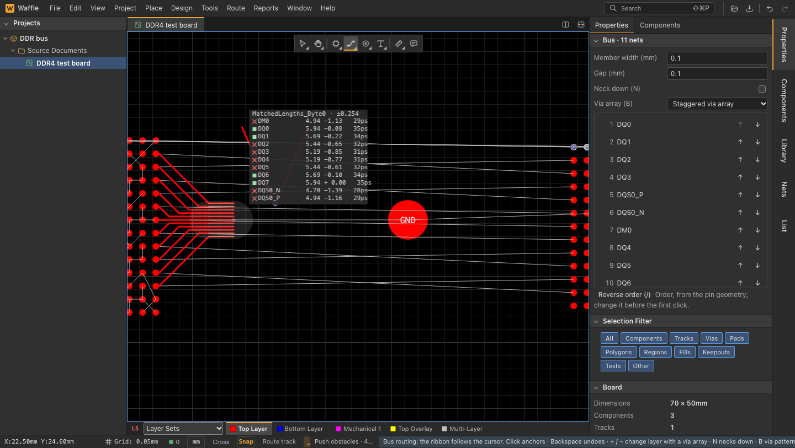
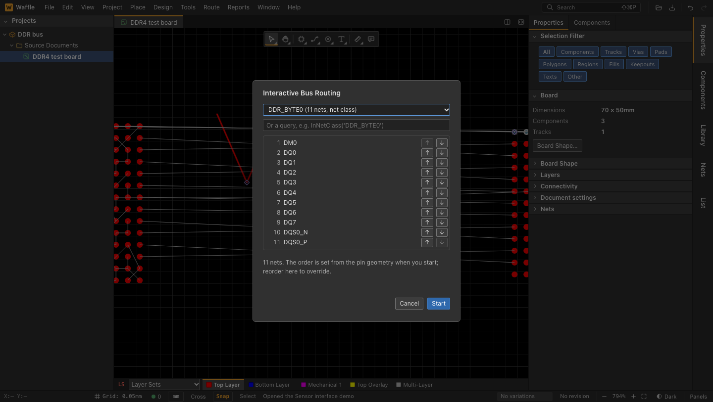
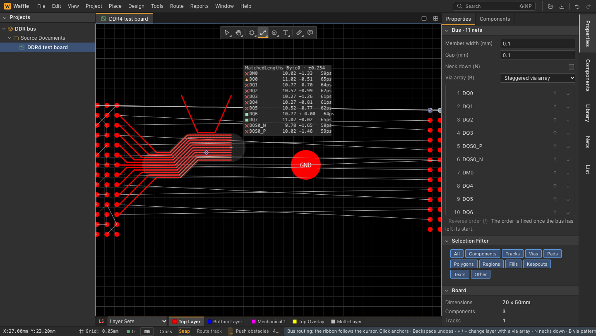
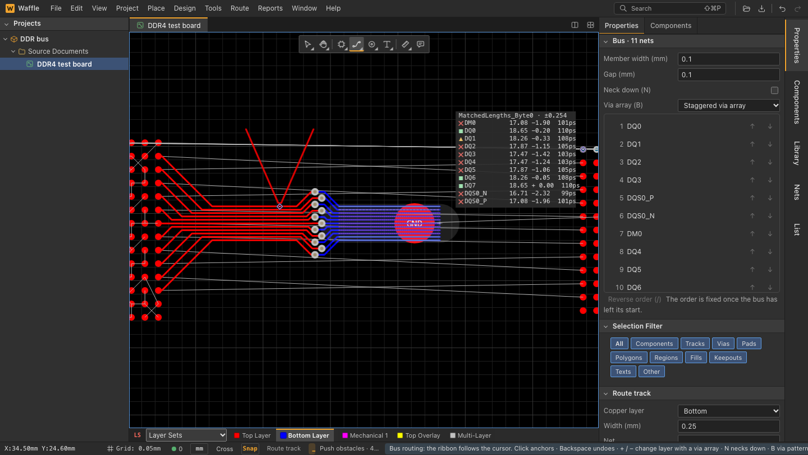
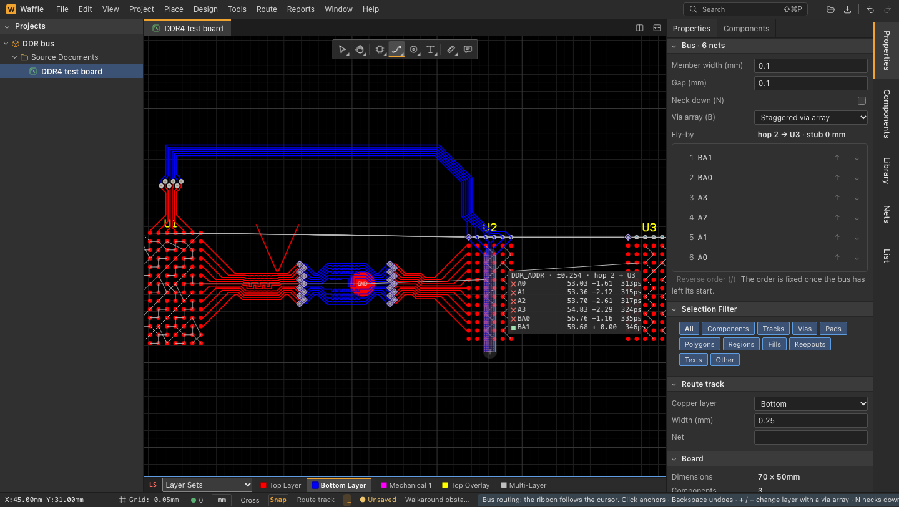
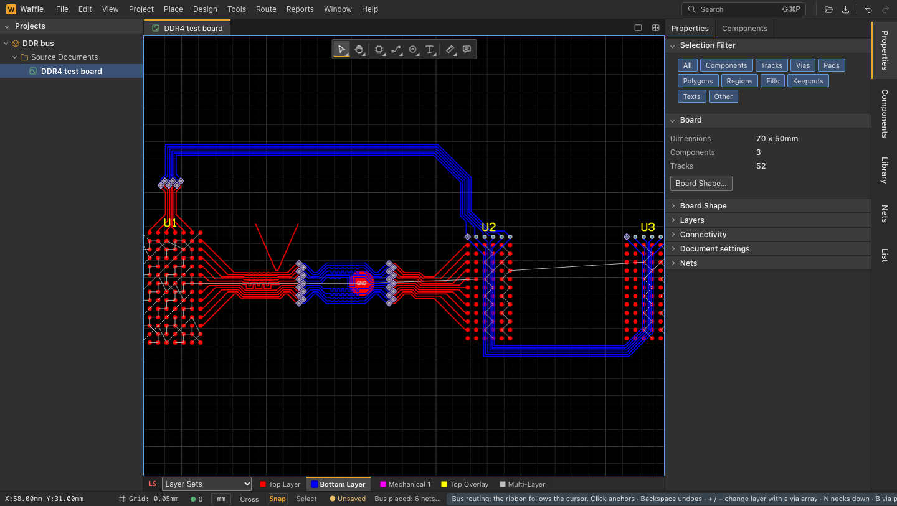
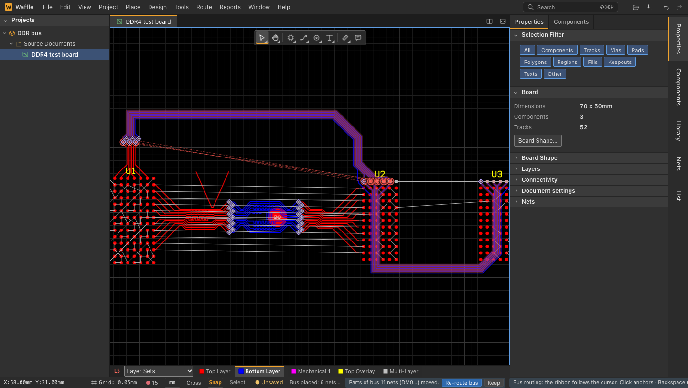
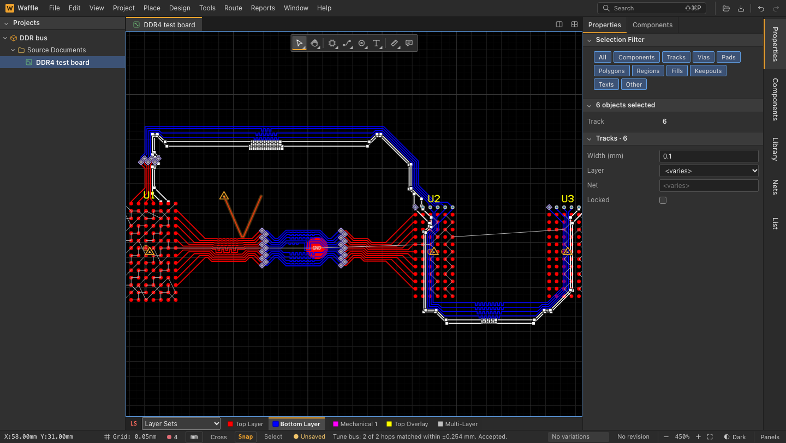
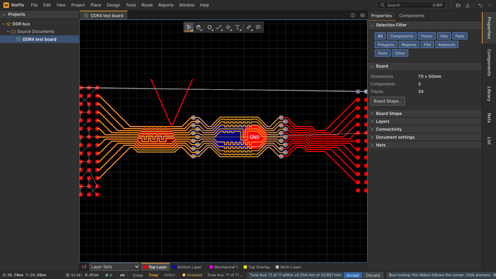
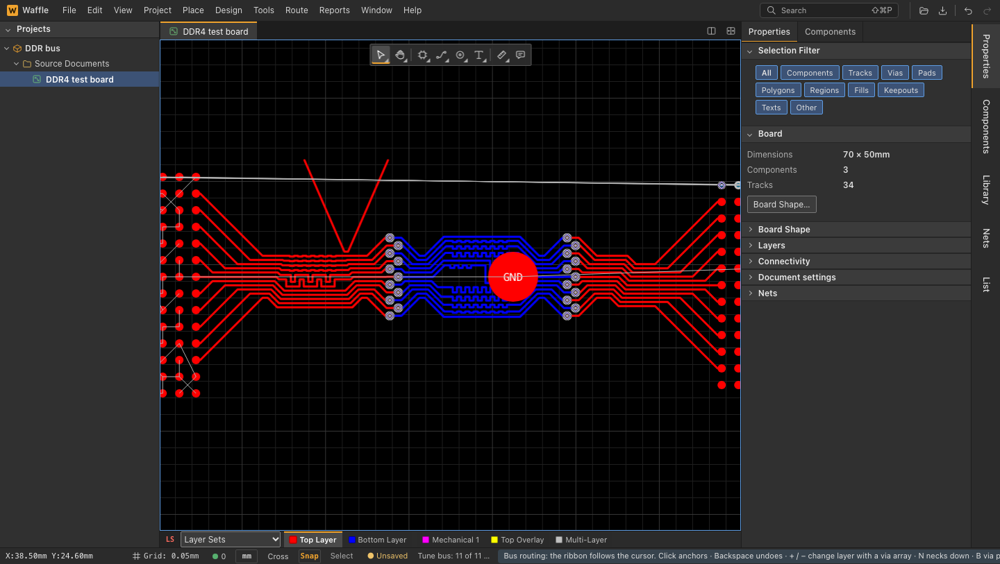

# Interactive Bus Routing

Route a whole memory byte lane (DQ0–7, the DQS pair and DM) or an address/command group as one ribbon that follows the cursor like a single track.

**Route › Interactive Bus Routing** (Altium key **P M**). The older Interactive Multi-Routing command (`route-multi`) now opens the same tool.

## Pick the bus

- **From the selection.** Select tracks or vias on two or more nets (a lasso works), then run the command or use the right-click menu on a track or via. Each net starts at its selected end nearest the selection's centre.
- **From a group.** With nothing selected, a picker opens. It lists net classes, matched-length groups (including timing and xSignal groups) and the xSignal classes made by Design › xSignals Wizard…. You can also type a query such as `InNetClass('DDR_BYTE0')` or `InxSignalClass('BYTE0')`. Then click near the source end, for example the controller's pads or the end of the fanout. Each net starts from its copper nearest that click.
- **Order.** The members are ordered across the direction of travel from the pin geometry, so nothing crosses at the source. A differential pair always stays adjacent. The picker shows the order, and ↑/↓ override it. While the ribbon is still at its start, **Alt+/** reverses it.

## Route it

| Input | What happens |
|---|---|
| Move | The ribbon follows. Members converge from their pads onto lanes with stacked 45° jogs (no two cross or come closer than the clearance), then run parallel at the pitch from the rules: width plus the clearance between neighbours, or a pair's own width and gap from Diff Pairs Routing. |
| Click | Anchors the ribbon up to the cursor. |
| Space / Shift+Space | Flip the corner or cycle the corner style, as in single-track routing. With 45° each member mitres exactly. With arcs the members become concentric arcs, so inner members are shorter than outer ones, by geometry. |
| Shift+R | Conflict mode. **Walkaround** walks the whole ribbon round obstacles as one wide track. **Push** hands every member to the router's shove engine together, so other nets' tracks and vias are shoved as in single-track routing, with walkaround as the fallback. **Stop** and **Ignore** behave as they do for a single track. |
| + / − / * (layer keys) | Drop a **via array** at the ribbon end and continue on the new layer. The ribbon spreads to the vias and converges again on the other side. The vias use the routing via style from the rules, and HDI spans and stacks come from the via templates. |
| B | Cycle the via pattern: **staggered** (two rows, compact across the bus) or **in-line** (one row). Either keeps the via-to-via clearance, and tracks pass between the vias at the clearance. |
| N | **Neck down** to the minimum width and gap from the rules (through a pin field), then **spread back out**. The transition keeps the narrow width until the members are at the wide pitch. |
| Backspace | Removes the last ribbon segment, including its shoves and vias. |
| Ctrl+click | **Reach a load, or finish.** The ribbon fans into the next load's pads (see Fly-by below), with no crossings. If that load is the last one, the bus is finished. If the pins are in a different order, swap-equivalent pins are swapped (symbol pin Swap group, for example DDR DQ bits within a byte), shown in the status bar and back-annotated with pin-swap.js. If the pins cannot be swapped, the tool says so and nothing changes. |
| N, B, / | These keys work while the bus is live. The same settings are in the Properties panel: a **Bus** section shows the member width and gap (editable before the first click), neck-down, the via array pattern, and the member order with ↑/↓ and Reverse. |
| Esc / right-click | Ends the bus. Anchored segments, shoves, vias and swaps are kept as **one undo step**. The floating head is dropped. |

## Fly-by (address, command and clock)

An address/command or clock group is one ribbon that visits every load in turn.

- **Load order.** The loads are visited in the topology's order (Constraint Manager › Topology, or the fly-by topology from Design › xSignals Wizard…; `AtriumTopology.specFor`), so the terminator comes last. Without a topology, loads are visited nearest first.
- **Reaching a load.** Ctrl+click anywhere reaches the **next** load.
- **Continuing.** The ribbon passes through the load's pads (via-in-pad balls, or pads on the routing layer), so the stub is 0 mm, well within any rule's limit. It then carries on from those pads on the same layer, in the same lanes.
- **Readout.** The panel shows the hop and the next load. After the last load the bus is finished.
- **Pin swaps** are never made at a load before the last, because the other loads share the nets.

**Tune Bus Group on a fly-by** tunes **hop by hop**, so the members arrive matched at every load, not just at the end. Each hop gets its own tuning zones. A per-hop target from the rule (`hopTargets` over MCP) is used where one is set.

## Live length and timing

A panel beside the ribbon head lists each member with these columns:

- length so far, in mm;
- Δ against the group, with a band in the theme's own success, warning and error colours (every theme, including Clearview, the colour-vision-friendly one). The band also has a shape (square within the tolerance, triangle within twice the tolerance, cross beyond) and a dash pattern along the track, so it never depends on colour alone;
- delay, in ps.

Each member's track also shows its colour band along the head.

- **Tolerance and target.** These come from the members' matched-length group: a Matched Lengths rule, a length group or an xSignal group, read with the high-speed suite's `AtriumLength.targetFor`. Without a group, the tolerance is 0.254 mm.
- **xSignal paths.** A member that is part of an xSignal (for example through a series resistor) reads its whole path.
- **Projected lengths.** While the bus is unfinished, Δ compares *projected* lengths: so far plus the straight distance to each member's destination. That shows the mismatch the route is heading for.

## Tune Bus Group

**Route › Tune Bus Group** works on the selected bus tracks or the last bus routed. It brings every member within its group's tolerance:

1. A packed ribbon has no room beside a member for a pattern, so the tool looks for a straight parallel run: 4 mm or longer first, then 2 mm, then 1.2 mm. On its longest straight parallel run, the ribbon **spreads into a tuning zone**: each member gets its own band and its own trombone of the right amplitude, and a differential pair is one coupled unit with a skew bump on its shorter member. Then the members converge again. A run that is too short for the whole correction is helped by the next straight run.
2. Any member still short afterwards goes to the length-tuning engine's accordion patterns.
3. The result is **previewed** in the theme's accent colour. **Accept** applies it as one undo step; **Discard** drops it.
4. The status line says exactly what happened, for example *"9 of 11 within ±0.254 mm of 32.6 mm · DM0 1.77 mm short, DQS0_N 0.4 mm short · no clean tuning zone (longest parallel run 3.1 mm): lengthen a straight run or give the bus room"*.

## Re-route Bus

Every bus routed in the session is remembered with its clicks, layer changes, neck-downs and loads.

When parts move, the status bar offers **Re-route bus**. The command is also on a bus track's right-click menu and is "Re-route bus" in the command palette. It routes the bus again from its pads' new positions with the same clicks, as one undo step. If the old clicks no longer work, it says why and leaves the bus as it was. A re-routed bus has lost its tuning, so run Tune Bus Group again.

## MCP

`route_bus` runs the same engine headless. It takes nets, a class or a query, a start point, centreline waypoints, layer changes, a finish point, `tune`, `swap_pins` and more. Like every edit it writes a proposal by default. See `mcp/README.md` › Bus routing.

## Limits

- **Fly-by stubs.** A fly-by passes through each load's pads, so the loads need pads on the routing layer (via-in-pad balls, or route on the pads' layer). Stub-and-via taps from an inner-layer trunk to SMD balls are not drawn yet.
- **Re-route Bus memory.** Re-route Bus remembers buses for the session only; after reopening the file, route the bus again.
- **Ball fields.** The ribbon starts at pads reachable from outside the field, or at fanout ends (vias, track ends). Break out a deep BGA first, for example with the autorouter's fanout.
- **Tuning zones.** A zone needs a straight parallel run of at least 1.2 mm. Accordions in corners are not used. Very short buses fall back to the length engine alone, which may leave members short; the status line says who is short, by how much, and why.
