# Collaboration

Waffle supports shared-folder collaboration and live co-editing. Both work without an account.

1. **Document locking and presence** (on by default in the desktop app). For projects in a shared folder (SMB/NFS, Dropbox, OneDrive, iCloud Drive) or a Git working copy. Each person edits different documents of the same project; others see who has what and get a read-only copy that reloads when the owner saves.
2. **Live sessions** (a prototype, off by default). Several people edit the same project at the same time and see each other's cursors, selections and activity.

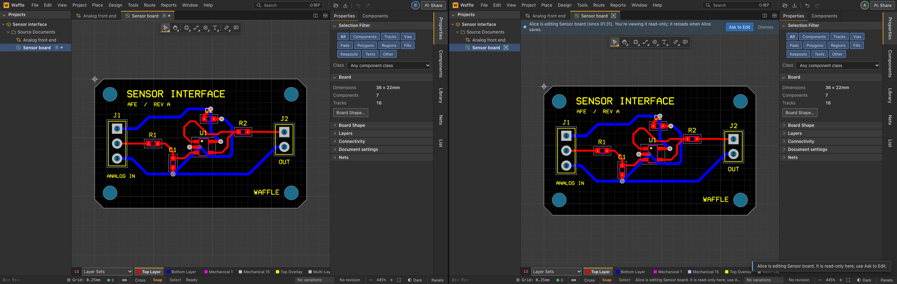

## Document locking

**What happens.** When you open a document of a saved project, Waffle takes its *edit lock*, a small file beside the manifest named `<project>.waffle.d-<document id>.waffle-lock`. Another person who opens the same document sees:

> Alice is editing Sensor board (since 10:42). You're viewing it read-only; it reloads when Alice saves. **Ask to Edit**

- **Read-only.** Edits to that document are refused with a short notice. Other documents stay editable: one person can work on the board while another edits a schematic sheet.
- **Live reload.** When the owner saves, your read-only copy reloads. Documents you changed are kept.
- **Ask to Edit.** The owner sees "Bob asks to edit Sensor board" with **Hand Over** (saves first if needed, then releases the lock) and **Keep Editing**. When it is handed over, your window takes the lock and reloads.
- **Take Over.** A lock whose owner's Waffle stopped updating it for 45 seconds (a crash, a sleeping laptop, a lost network share) is shown as stale. Take Over, after a warning, takes it. If the owner was still editing, their next save stops with a conflict instead of overwriting you.
- **Presence.** The document tabs and the Projects tree show a small initial for who edits (ringed) or views each document.
- **Release.** A document you have not looked at for two minutes and have not changed is released automatically. Project › Release Document Lock releases the current one; closing the project or window releases everything.

**Saving.** The project stays one `.waffle` file; each document is a *merge region*. When you save and someone else saved first, Waffle merges three ways, region by region: each document, each library part, each review comment and each other project setting.

- A region only they changed comes from the file; a region only you changed is yours.
- A document's lock decides it: the holder's version wins, so data recomputed in a read-only window (live pours, designators) never causes a conflict.
- A region both of you changed is a conflict. Nothing is saved, and the bar offers **Compare with Theirs** (the visual diff: your version against the file), **Keep Mine**, **Save a Copy…** and **Discard Mine and Reload**.

**Changes from other programs.** Git (checkout, pull, merge, restore) and sync clients rewrite the project file too. With no unsaved changes the window reloads. With unsaved changes in other regions it merges. With overlapping changes it shows "The project file changed on disk…" with Compare with Theirs, Keep Mine and Discard Mine and Reload. Waffle never writes over a file that changed since it was read; the desktop host refuses such a write as well.

**Your name.** Preferences › Collaboration › Your display name. Waffle never uses your account name, computer name or email. The lock file also holds a random machine id (made once, stored in Waffle's settings folder), a per-window session id, the process id and the time.

**Git.** Add `*.waffle-lock` to `.gitignore` so local editing locks stay in the shared folder. An atomic lock update uses a temporary `.waffle.pending-<unique>.waffle-lock` file beside the lock and removes it on publication. Other editors only list the published lock. For teams that use **Git LFS locking**, Project › Collaboration… shows whether the repository marks `.waffle` files lockable (`*.waffle filter=lfs diff=lfs merge=lfs -text lockable` in `.gitattributes`) and whether git-lfs is installed. That check is local. **Check Locks**, **Lock on Server** and **Unlock on Server** contact your LFS server with your own Git credentials, only when you press them and after a confirmation.

**Turning it off.** Preferences › Collaboration › "Lock the documents I open".

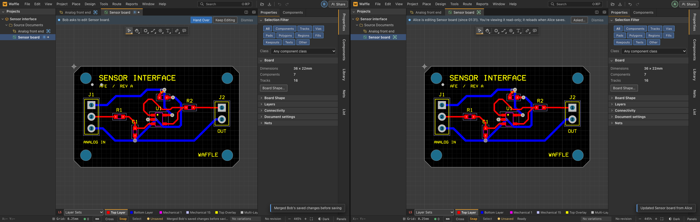

## Live sessions (prototype)

Use **Share** at the top right of the editor to start or join a session. **Project › Live Session…** opens the same controls.

A session shares the project you chose. Opening another project, creating one, or restoring a separate copy leaves the session in that window. Canceling the switch keeps the session open.

When joining, choose **Save and Join** to keep unsaved edits in a file or **Keep Editing** to stay in your project. If you start an edit while waiting for the shared design, Waffle keeps your work in this window and cancels the join. You can finish and save, then join again.

### Set up a relay server once

Live sessions between computers go through a relay server that you run: a small Linux server with the Waffle relay, a TURN server and a certificate. [deploy/collab-server](../deploy/collab-server/README.md) sets one up on AWS Lightsail (or any Ubuntu 24.04 server) from one launch script. Then enter its address in **Preferences › Collaboration › Relay server**, for example `wss://collab.example.org`, and turn on **Enable live sessions**. Anyone with the address can host; on a server its owner made private, open the host invitation link they sent you instead. Waffle never contacts a server you did not enter.

Without a relay server, **Start Session** hosts with pairing codes (below), computer to computer; a window without WebRTC keeps the session between windows on this computer.

### Host and invite

1. Choose **Share › Start Session**. The project in this window becomes the shared project.
2. Choose **Copy Link** and send it privately (chat, e-mail). **Copy as Text** gives the same invitation as three lines (relay, room key, host) for places where links are awkward.
3. A guest opens the link (or pastes it, or the text, into **Share › Join**) and chooses **Join Session**. The shared project replaces the project in their window, as an unsaved copy.

Anyone with the invitation can join and edit while the host keeps the session open, so share it like a password. The room key and a fresh session salt travel after the `#` in the link: browsers never send that part to a server, and Waffle removes it from the address bar once the join form opens. (Whoever controls the server could change its `/join` page to read the address bar; Waffle never loads that page, and the server kit keeps it static.)

**How editors connect.** Each pair of editors tries a direct WebRTC connection first. When their networks do not allow that, WebRTC goes through the TURN server beside the relay. When WebRTC is unavailable or blocked, edits go through the relay server itself. Every path carries the same end-to-end encrypted messages. The session controls and the status bar show which path each person uses: **direct**, **via TURN** or **via relay server**. A direct connection shows each editor the other's IP address; **Preferences › Collaboration › Connection › Only through TURN** avoids that, and **Always through the relay server** skips WebRTC.

**Different Waffle versions.** Editors on the same file format share a session; a different app version shows as a label in that person's details (keyboard focus or People here). Someone on a newer minor format gets one notice: objects only their Waffle understands are kept unchanged and not shown in yours, exactly as when you open their file, and your edits never remove them. A newer major format or transport protocol cannot share a session. When the host uses one, Waffle says "Update to join" and leaves your project as it was; when someone else does, you get a notice and the session goes on. Only the host changes the file's format stamp. If objects from a newer Waffle are set aside, the session controls say how many, and the host can discard them for everyone.

WebRTC is available in the macOS app (WKWebView), the Windows app (WebView2) and current browsers. In the Linux app it depends on the system's WebKitGTK build; without it the status reads **relay server only** and everything else works the same.

**Without an invitation.** Under **Use a room key instead**, enter a relay server and a room key of at least 24 characters (**Generate** makes one), then **Start with This Key** or **Join with This Key**. A guest who joins this way cannot verify the host, so shared restore is unavailable to them.

### Other ways to connect

**Share** has one button to host and one field to join; everything else is under **Other ways to connect** in the session controls.

| Way | When | What the host does | What the guest does |
|---|---|---|---|
| **Link** (default) | A relay server is set | Start Session, then Copy Link, Copy as Text, or show the QR code | Opens the link, or pastes it into Join |
| **Pairing code** | No server at all, or a guest who cannot reach the server | Create Pairing Code, send it; paste the reply that comes back | Pastes the code into Join, sends back the reply it shows |
| **Same network** (the Waffle app on macOS and Linux) | Everyone on one Wi-Fi or office network | Ticks **Visible on this network**, names the session, Start Session, reads out the 16-character code | **Find Sessions on This Network**, chooses it, enters the code |
| **Address** | A host who shares on the network, reached by address (another subnet, or a port the user forwarded) | As above; the session controls show `address:48765` | Types the address into Join, then the code |

A pairing code carries a WebRTC offer and the session's key, so share it like the link; the reply carries only the guest's connection details. The two computers connect directly (on the same network, or when one of them is reachable), with no relay, STUN or TURN server. In a session with a relay server, the host carries a paired guest's traffic to the relay; without one, the host's window is the relay. Each code is for one guest and one use. Everything stays end-to-end encrypted with the session key, as on every other path.

**Visible on this network** is off by default. Only while such a session runs does the app listen (the Waffle relay protocol on port 48765, or another free port, on Wi-Fi, Ethernet and loopback only, never cellular, VPN, container or virtual-machine interfaces: on Linux, only physical interfaces with a device under `/sys/class/net`, never `docker*`, `br-*`, `veth*`, `virbr*`, `tun*`, `tap*`, `wg*`, `tailscale*` or `zt*`) and announce `_waffle._tcp` with Bonjour (macOS) or avahi (Linux). The announcement holds the session name the host typed (the project name is suggested) and the port, nothing else from Waffle; the operating system publishes it under the computer's existing local network name, as it does for any shared service. Before joining, a guest's Waffle asks the listener only for the session's public facts (its salt, name and the host's peer id); joining needs the code, which is the session key: 16 characters (about 79 bits), stretched like every room key with the session's salt, so the code is never sent and cannot be guessed from what is announced. The invitation names the address of the interface carrying the default route (Linux), else the most likely local network (192.168/16, then 10/8, then 172.16/12, IPv4 before IPv6). Leaving the session, closing the window or reloading stops the listener. On macOS, Waffle explains the Local Network permission once before macOS asks. The Windows app does not have this yet and says so; in a browser, Share says it needs the Waffle app. Joining by address works anywhere a WebSocket can reach the listener.

**Join** takes whatever the host sent: an invitation link or its text, a host invitation for a private server (sets up hosting instead), or a pairing code. It says which one it recognised before anything connects.

**People** in the session controls are buttons: each shows the person's connection (Direct, via TURN, via the relay server, through the host, Connecting). Choosing one explains it in a line below; there are no hover pop-ups. **Preferences › Collaboration › Test Connection** opens a connection to the relay server and reports whether it answered, how fast, and whether it offers TURN.

Everything works from the keyboard (Tab order follows the reading order; Enter in the Join field joins) in both themes, and notices appear in the status line without blocking.

| Dark | Light |
|---|---|
| 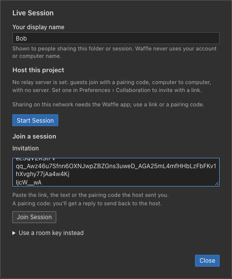 | 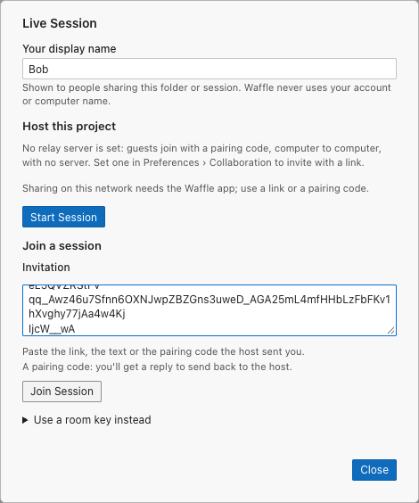 |
| 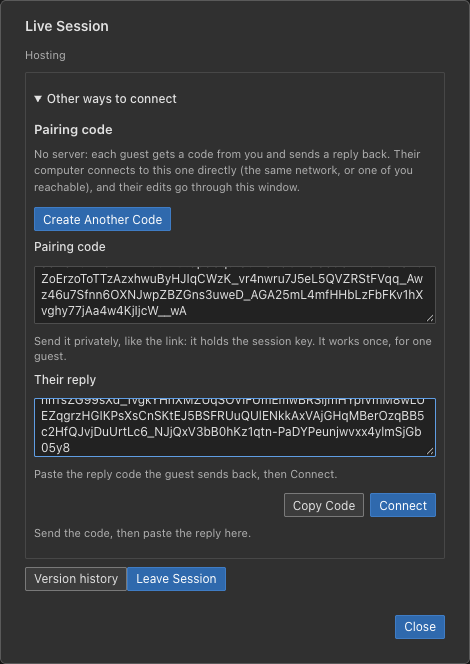 | 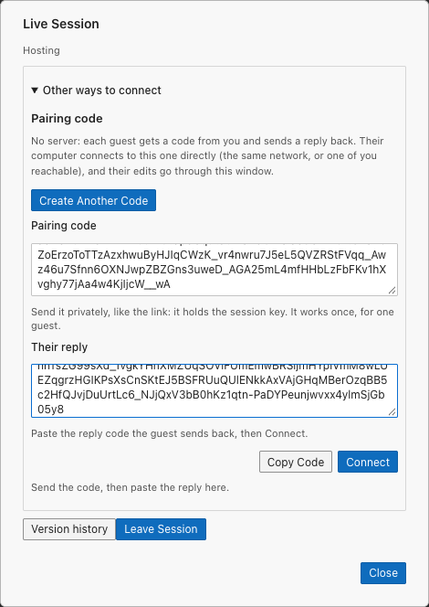 |
| 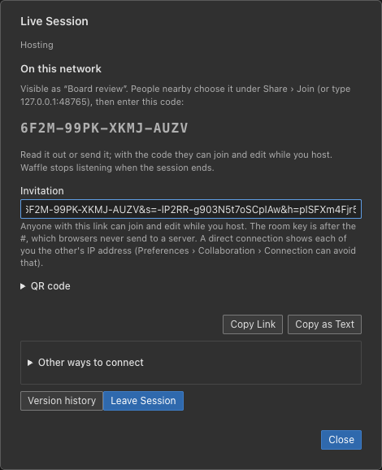 | 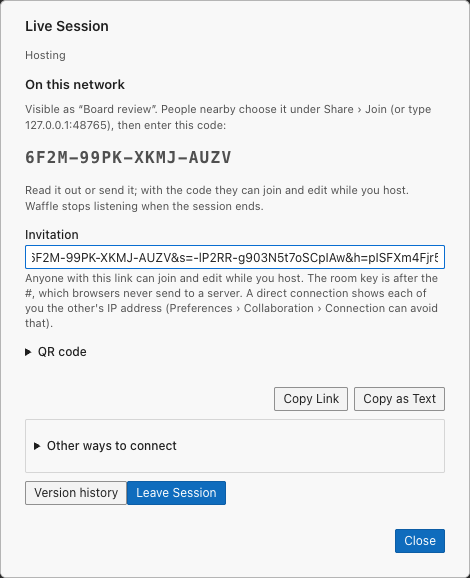 |
| 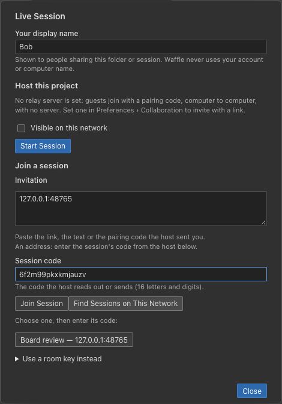 | 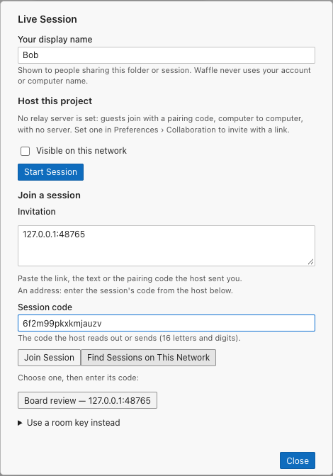 |
| 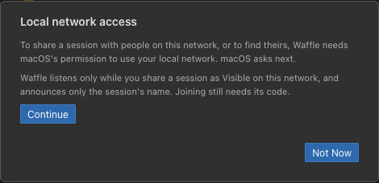 | 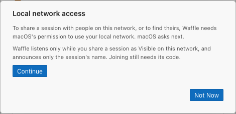 |

**Checks.** `native/tests/lan_relay.py` runs the Linux listener and, on macOS, compiles `native/macos/LanRelay.swift` with a small driver and runs the same protocol checks on loopback (info, one room, tokens, messages, signalling, leaving, stop). `tests/collab-pair-browser.cjs` drives the dialog in Chrome against the Linux listener. Bonjour and the permission prompt need a person, on two Macs on one network (hand-run, before a release):

1. On a Mac that never ran Waffle's network features: Share, tick Visible on this network, Start Session. Waffle's explanation appears first; Not Now starts nothing (`lsof -iTCP:48765` shows no listener). Continue: macOS asks for Local Network access; allow it.
2. The session controls show the code and `address:48765`. `dns-sd -B _waffle._tcp` on the other Mac lists the session name only; `dns-sd -L "<name>" _waffle._tcp` shows the port and `v=2`.
3. On the other Mac: Share › Find Sessions on This Network lists it; choose it, type the code in lower case without dashes, Join: the project arrives, edits flow both ways, the people list says Direct.
4. A wrong code does not join. Typing `address:48765` and the code joins the same way.
5. Leave Session on the host: `lsof -iTCP:48765` is empty and `dns-sd -B` no longer lists it. Repeat with closing the window and with reloading.
6. With a VPN connected, `lsof -iTCP:48765` shows no listener on the VPN's utun address (connections there are refused).

### See who is here

The host sees **Sharing** even while waiting for the first guest. Guests see **Waiting…** until the shared project opens, then **Live**. Click that control to reopen the session controls and the invitation. Leaving returns the button to **Share**.

Coloured initials beside the button show the other people in the session. Keyboard-focus an avatar to see the person’s name and current document; nothing pops up on hover. Click or tap it to open **People here**. A **+N** button shows the rest of a larger group. When using a shared folder outside a live session, these avatars show who else has the project open and which documents they are viewing.

<picture>
  <source media="(prefers-color-scheme: dark)" srcset="images/collab-people-dark.png">
  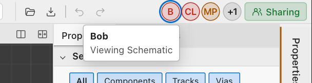
</picture>

### In the session

- **Live cursors** share key positions when someone starts moving, turns, crosses a long distance or stops. Each viewer animates the pointer locally between those positions. Reduced motion shows each position immediately. Names stay beside their pointers, and selections are outlined in each person’s colour. [Watch two cursors cross on a board](images/collab-cursors.gif)
- **Remote board and schematic objects** glide when moved and fade in or out when added or deleted, with only the fades visible in reduced motion. [Watch a collaborator add, move, and remove a via](images/collab-object-motion.gif)
- **Moving or resizing an object.** Peer cursors stay live while you drag. Incoming design edits appear when you drop the object or press Escape. If a large batch arrives during a drag, the editor cancels the drag and applies the waiting edits.
- **Activity**, such as "Alice is routing GND" or "Bob is moving R5", on the cursor and in the status bar.
- **Follow** a person: click their name in the status bar. Their document and view follow along.
- **Soft locks.** While someone drags an object or the router moves existing copper, a calculator, saved proposal or script targeting a claimed object stops before creating an Undo step. Other edits to a claimed object are reverted with a notice. Editors use the same tie-breaker if two claims arrive at once. Other objects remain editable. Edits made before a claim arrives still merge through the session’s normal rules. Run `node tests/collab-pair-browser.cjs --edit-locks` with Chrome and playwright-core to check the two-window review and Undo flow locally.
- **Undo is per person.** Undo and Redo act on your own edits. If you both change the same property, your Undo can reveal the other person’s value. If you place an object and someone else starts editing it, their work stays visible. Personal Undo and Redo require everyone in the session to use a compatible editor.
- **Offline.** If the relay drops, you keep editing. Your changes sync when it comes back, and the same happens if you rejoin later with the same window.
- **Who may change what.** Every editor proves who it is when it connects, and each live edit must be its sender's own. Only the host named in the invitation can bring a reconnecting editor up to date with other people's edits, merge a full snapshot, or restore a version for everyone. If the host has left, guests keep editing together and catch up on each other's own edits.
- **Energy.** Nothing polls while nobody moves: presence is a 20-second heartbeat, a dragged object's soft lock refreshes every 4 seconds only while it is dragged, and cursor positions travel only when the pointer moves.

An older editor can join and exchange ordinary edits. If it was disconnected long enough to need a fresh snapshot, or someone used personal Undo while it was away, leave and rejoin from that editor to load the current design. Save any private work first.

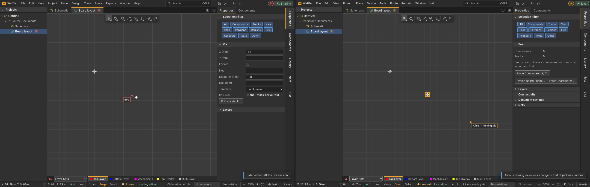

### Version history and restore

Open **Sharing** or **Live**, then **Version history**. The timeline on your computer shows local snapshots and, for a saved file in a Git repository, its commits. Choose **Save checkpoint** to mark a version yourself. While you edit, automatic history adds a version about once a minute. Unchanged parts of the project share storage. The timeline keeps up to 20 local versions per project, with fewer versions further back.

- **Compare** opens the usual **Review Changes** view. Anyone can choose **Restore copy** to open that version privately. This leaves the session in that window.
- As the host, choose **Review restore…** to compare the current shared design with the proposed version. Choose **Restore for everyone…** and confirm when you’re ready. If someone edits the design after the comparison, review it again. A guest with an unfinished edit can finish it before you retry.
- The host’s timeline saves **Before shared restore** before applying the change and records **Shared restore** afterward. To recover a detail from the previous design, open the earlier checkpoint as a copy. To reinstate it for everyone, review and restore that checkpoint.

**How it merges.** Every document, part, track and other object has a stable id, so the project is a set of objects. Objects form an add-wins set: a delete never removes an object someone re-added at the same time. Each property is a last-writer-wins register. Track, wire and polygon vertices are a sequence CRDT (RGA), so two people inserting vertices into one track keep both. Order (documents, items) is a fractional index. Any delivery order of the same changes gives the same project. `tests/collab-crdt.cjs` checks this with randomised concurrent edits on three replicas and with every change applied in shuffled order. The log of changes is bounded; a window that falls further behind receives a snapshot.

**Limits of the prototype.**

- An edit costs what it changed, not the size of the project. Waffle publishes items changed, added, removed, pasted or reordered on a sheet or board straight from the Undo history. It applies a collaborator's edit by validating and patching only the objects it touched. Edits to the document list, the library, project settings and live pours still compare or rebuild the whole project. A live pour sends the board's whole poured copper after each copper edit.
- Shared restore needs the host; a guest that fell behind the bounded history while the host was away waits for the host to return.
- Guests can use **Save As** to keep a project file. Hosts can use **Save** to write everyone’s edits to the shared project’s file.
- It is not merged with document locks.

## Threat model

**Assets.** The design (intellectual property), the integrity of each person's project, each person's identity details, and the computers running Waffle.

**Document locks (shared folders).**

| Threat | Mitigation |
|---|---|
| Page script writes elsewhere through the lock API | The host writes `<project>.waffle.<key>.waffle-lock` in the open project's own folder. The key is 1–64 of `[A-Za-z0-9_-]`, starting with a letter or digit, so there are no separators or dots. The data is a JSON object of at most 8 KB. The host creates with `O_EXCL\|O_NOFOLLOW` and replaces by renaming into place. Coverage includes `native/tests/collab_locks.py` on macOS and Linux, the Windows `CollabLockTests` and the macOS harness's stray-file check. |
| Someone else's lock file is overwritten or deleted | Replace and remove refuse unless the file names this window's session. Take-over is a separate, explicit mode the user confirms. |
| Hostile lock content from another machine | Lock files are untrusted input: size-capped (16 KB), strictly parsed, names cleaned of control and bidi characters, and an edit lock must match its own file name. Display text is never HTML. |
| Clock skew between machines makes locks look stale | Staleness is observed on this machine: a heartbeat that has not changed for 45 s here. Only a lock more than 10 minutes old by the host clock is stale at first sight. |
| Lost work from concurrent saves | A three-way region merge before saving. Overlaps stop the save and offer Compare, Keep Mine or Discard. The native host also refuses to write over bytes that changed since it read them. |
| Privacy | Only the display name you type, a random machine id and the process id are written. No account, hostname or email. |
| Locks are advisory | Anyone with write access to the folder can delete a lock file, or edit the project with another tool. Locking prevents accidents, not malice; the merge-on-save catches the result. |

**Git LFS.** Waffle disables repository-supplied code when fetching LFS files.

- Git runs only through `git_head.py`'s safe runner: SAFE_CONFIG, which includes `safe.bareRepository=explicit` for every query, `--literal-pathspecs`, a scrubbed environment and `GIT_CONFIG_NOSYSTEM`.
- git-lfs runs by its absolute path, never as `git lfs`, so `alias.lfs` cannot apply. Status runs only `git-lfs version`, outside the repository.
- Server operations run only on a button press, after a confirmation. They use fixed arguments, no terminal prompt, a 30 s timeout, and safe settings for the Git commands git-lfs starts (`GIT_CONFIG_PARAMETERS`).
- Server operations are refused when the repository's own (local or worktree) config sets a key that runs a command or redirects the connection: `core.sshCommand`, `credential.*helper`, `lfs.customtransfer.*`, `remote.*.uploadpack` and similar.
- The bridge and all three hosts allow the same operations.

Regression tests: `tests/security-git.py` (`LfsQueriesRunNoRepositoryCode`) and `native/tests/git_lfs_locks.py`.

**Live sessions.**

| Threat | Mitigation |
|---|---|
| The relay or TURN operator reads or alters the design | End-to-end encryption on every path (WebRTC direct, through TURN, or through the relay): AES-256-GCM under a key derived from the room key (PBKDF2-SHA-256, 310,000 rounds, then HKDF). The servers see only ciphertext, sizes, timing, room ids and connection addresses. The room id is in the additional data, so ciphertext cannot be moved between rooms. A tampered message fails to decrypt and is dropped. WebRTC offers, answers and candidates are sealed with the same key, so only room members can open a data channel to each other. |
| The room key reaches a server | Invitation links carry it after `#`, which browsers never send; Waffle clears it from the address bar. The relay's `/join` page has no secrets and no logs (a compromised server could change it to read the address bar). |
| An old session is replayed, or senders' nonces collide | Each invitation carries a random salt for PBKDF2, so a reused room key gives new room ids and keys. Each sender has its own AES-GCM key (HKDF info names its peer id) and the additional data names the sender. Manual room keys need 24 characters. |
| Strangers use the server (and its TURN bandwidth) | Open by default, so quotas do the work: sessions, connections and joins per address (IPv6 /64), idle sessions closed after two hours, TURN credentials (1 hour) only for members the session's host vouched for after their proof of the session key, while two are present, a bounded number per session and address each hour, per-allocation and total bandwidth caps in coturn (UDP only, `no-tcp-relay`) and a monthly TURN cap after which sessions fall back to direct and relay paths. A private server (`waffle-collab mode private`) admits only hosts with a personal, revocable invitation; guests still need only the session link. |
| Strangers on the local network | Nothing listens unless the host shares a session as Visible on this network, and only until it ends. The announcement holds the session name and port only. A guest needs the 16-character code (the session key, stretched with the session's salt by PBKDF2); without it they cannot join or read anything, and the listener admits only that session's room, 16 people, with the relay's message, rate and queue limits. A fake announcement on the network does not get the code either: a guest's Waffle sends only a join token derived from it, too costly to reverse. Tests: `native/tests/lan_relay.py`, `tests/collab-pair-browser.cjs`. |
| A pairing code is intercepted or altered | A code holds the session key, like a link: send it privately. It is good for one guest, once; the host pastes the reply itself, so a reply cannot connect anyone the host did not choose. The data channel is DTLS-encrypted, and the session's own end-to-end encryption, identities and checks apply unchanged on top; in a session without a server, the host's window runs the relay protocol (same join check, 16 people, a guest that stops reading is disconnected). Codes and replies are size-limited and parsed as data only. Tests: `tests/collab-pair.cjs`, `tests/collab-pair-browser.cjs`. |
| Participants learn each other's addresses | A direct WebRTC connection reveals IP addresses to the other participant. **Only through TURN** hides them. |
| A participant speaks or edits as someone else | Each editor makes an ECDSA P-256 key per session; its peer id is a hash of the public key. It signs (room, its relay connection id) when it connects, and others accept its messages only from that connection (on the relay or on the data channel negotiated with it). A live edit is applied only when every operation carries its sender's own replica id; add tags and element ids follow from that stamp, so nobody can add, change or undo in another person's name. Tests: `tests/collab-transport.cjs`, `tests/collab-crdt.cjs`, `tests/collab-session.cjs`. |
| A participant inflates counters or authors | Lamport clocks may run at most 10^6 ahead and stay below 2^48; sequence numbers at most 40,000 past what a replica holds; nobody may claim edits by the receiving replica; at most 256 authors per session and 32 contributions per property, cut the same way on every replica. A snapshot that breaks any of these is refused before it changes anything. |
| A participant forges history or a shared restore | The starting project, catch-ups that carry other people's edits, merge snapshots and shared-restore boundaries (which retire personal undo history) are accepted only from the host named in the invitation, verified by its signature; only if the host is away for 15 s after the guest connected does a guest start from another participant's copy, with a warning. Such a guest says so when the host arrives, sends the host its own edits and takes the host's copy whole; a host also replaces a copy that claims more of its edits than it made. A snapshot whose counters exceed its own clock is refused. From anyone else, a catch-up is cut down to the sender's own edits. A version (protocol number or file format) from anyone but the verified host is only a notice, so nobody can make a guest leave. Only the host may change the format stamp (`format`, `formatVersion`, `version`, `compatibleWith`). Leave and Join again in the same window keeps the replica's edit count, so the host's copy of its earlier edits is accepted. |
| A host invitation token leaks through settings | It is kept apart from Preferences (which export, import and sync), under its own browser storage key, and Preferences never store keys that look like credentials. |
| An editor's memory | Bytes waiting for decryption (24 MB), for a proof of identity (2 MB) or for a path marker (32 MB) are bounded per connection, and a connection past twice the sender rate is dropped before decryption; large messages reassemble per sender. |
| Strangers join a room | Joining needs the room's join token (HKDF of the room key); the relay checks SHA-256(token) = room id. A token says nothing about the encryption key, so a relay that learns it can let someone in, but they cannot read or forge messages. |
| A weak or leaked room key | Generate makes 130-bit keys; keys shorter than 16 characters are refused; keys are never stored, logged or put in URLs. Anyone with the key is a full participant: share it like a password, and use a new one per session. |
| Replay | Each sender numbers its messages. Receivers drop repeats and older numbers. A new guest adopts a snapshot, and a reconnecting editor merges a catch-up snapshot with its current state. Changes carry their original author and logical time. |
| A malicious participant sends hostile operations | Remote operations are untrusted. Each batch is checked whole before any of it applies: exact shapes, finite numbers, bounded depth and size, no `__proto__`, `constructor` or `prototype` keys, safe ids. The result is materialised through `Atrium.validate`, the same model validator as a file load; objects that fail it are left out, the same way on every replica. While the shared project is valid as a whole, an edit validates only the objects it touched. This includes each edited part's library definition and its document's kind. Anything whose validity reaches further rebuilds and validates the whole project. That covers a changed definition, a document's kind, the compatibility stamp, documents whose rules read their items, and any object that fails. `tests/project/collab-scoped-equivalence.cjs` checks this against whole-project validation with hostile and invalid batches. Cursor fields are cleaned. Each sender is rate-limited (600 messages or 32 MB per 10 s, then muted for 30 s), and bodies are capped at 8 MB. A participant can still make valid but unwanted edits; they are visible to everyone, and per-user undo cannot undo someone else's changes. |
| Resource exhaustion at the relay | Frames are capped at 1 MB and signalling at 64 KB; 16 peers per room (the owner may still join), 256 rooms, 512 connections, 32 per address (an IPv6 /64 is one address) and 60 joins per address per minute; past 400 messages or 24 MB per 10 s a connection is slowed down (never cut off, so the host keeps its own room); each peer has its own outgoing queue (6 MB); a sender stops being read while a recipient is 3 MB behind, a recipient that stays behind for 5 s is disconnected, and all queues share one 128 MB budget, checked before anything is queued; messages being read reserve memory too (160 MB for all connections, eight bytes per byte received), and a sender waits before it is read; one address may join one session 20 times in 10 minutes (each join is a new identity, and sessions allow 256 authors); a 10 s join timeout and a 10 minute idle timeout. Unmasked, binary or fragmented-control frames close the connection. In the editor, each data channel has its own queue; a stalled one falls back to the relay and resyncs. |
| TURN abuse | coturn accepts only credentials minted by the relay for admitted rooms (HMAC-SHA1 with a secret that never leaves the server, valid for 1 hour), relays UDP only and to no private, loopback, link-local, documentation, NAT64, 6to4 or Teredo address, and has per-user and total allocation quotas. |
| Network exposure | The standalone Waffle relay listens on loopback by default. The server kit runs it as an unprivileged, sandboxed service behind Caddy (TLS) and opens only 22, 80, 443/tcp, 3478 udp+tcp, 5349/tcp and the TURN relay range. Waffle contacts only the relay server you enter. |
| Not covered | Traffic analysis by the relay operator; participants who share the key; a compromised computer of a participant. |

## Files

- **Locking:** `app/collab-lock.js`, which holds the lock protocol, the three-way region merge and the save, reload and read-only wiring.
- **Presence UI and live sessions:** `app/collab-presence.js`, which holds the badges, bar, dialogs, Preferences page and `AtriumCollabLive`.
- **CRDT:** `app/collab-crdt.js`.
- **Encrypted transport (WebRTC, relay, invitations, identity):** `app/collab-transport.js`.
- **Styles:** `app/collab.css`.
- **Relay:** `collab/relay/waffle_relay.py`. **Server kit:** `deploy/collab-server/` (launch script, `waffle-collab` helper, README).
- **Hosts:**
  - macOS: `CollabLocks` in `native/macos/HostState.swift`.
  - Linux: `CollabLocks` in `native/linux/waffle.py`.
  - Windows: `native/windows/src/Core/CollabLocks.cs`.
  - Git LFS: `lfs_query` in `native/git_head.py`.
- **Tests:**
  - `tests/collab-crdt.cjs`, `tests/collab-transport.cjs`, `tests/collab-session.cjs`, `tests/collab-lock.cjs` and `tests/collab-relay.py`.
  - `tests/project/collab-convergence.cjs` (randomised convergence along the session's paths) and `tests/project/collab-scoped-equivalence.cjs` (scoped publication, validation and patching against the whole-project paths).
  - `tests/project/collab-remote-scope-browser.cjs` (Chrome): a remote move, property edit, add or delete re-checks only what it touched on the benchmark board.
  - `scripts/perf-collab.sh --budgets`: per-edit cost, the change set a remote edit gives online DRC, and bytes on the wire, on the 25,600-object benchmark board.
  - `scripts/collab-smoke.py RELAY`: two headless editors against a relay, per path (direct, TURN, relay).
  - `native/tests/collab_locks.py` and `native/tests/git_lfs_locks.py`.
  - The Windows `CollabLockTests`.
  - The two-window demo `scripts/collab-demo.py`, which takes the screenshots above.

## Group libraries

Open the Library panel in either editor and choose **Group library…** in its source selector. Create a group, enter the display name you want in the revision history, and choose **Propose revision…**. Select a project component, describe the change and choose its lifecycle after approval (draft, review, released or deprecated). A removal is also a proposal. The group keeps component definitions, embedded 3D models, full revision ancestry and review decisions in this profile’s local storage.

Open **Review…** to compare symbol and footprint overlays, pins, pads, parameters and source credit. **Approve for my library** installs the reviewed revision in your copy. The history identifies the person who proposed or approved each change. Someone else’s approval appears in the history and leaves your copy waiting for review. Divergent versions of the same component open a **Merge review**. Choose the version to keep and approve the merge. Both parents remain in the history. Closing the review leaves the proposal pending.

Select the group in the Library panel to place an approved component or add it to a project. The project keeps its own version. To adopt a newer group revision, use its **Update from library** review.

- **Library-only session.** Expand **Library-only session** and select **Start library session**. Copy the invitation to members using your usual channel. They paste it into the same field and select **Join library session**. The session uses the relay and connection settings in Preferences › Collaboration. An empty relay setting shares between local windows. This room exchanges group records and leaves the project private. The invitation is kept in memory. **Leave library session** disconnects and retains your copy.
- **Existing project session.** Select **Share this group in session**. Other members choose **Find groups in session**, then **Join** beside the group name. This uses the project session’s existing encrypted connection, including paired and LAN sessions. Sharing a different group requires a new selection. New members receive the full history. Returning members request missing records. Local edits made offline remain available for review after reconnection.
- **Bundle.** **Export bundle…** writes a self-contained `.atrgroup` file. Importing one adds its proposals and history to the matching group. The same bundle can be imported repeatedly.
- **Git.** In a browser with writable directory access, **Save to Git checkout…** adds immutable files under `waffle-groups/<group-id>/` in the selected checkout. In other hosts, **Export Git files…** produces the same directory in a ZIP. Extract it in the checkout. Commit, pull and merge with your usual Git client. Then choose **Read Git checkout…** and select the checkout to review its new proposals. Each revision and review decision has its own file. Two Git branches editing the same component retain both proposals for a visual merge. Waffle writes no Git configuration and runs no Git commands for this workflow.

The proposal carries the component’s structured source metadata, including nested footprint attribution and any supplied licence notice. Copies linked to older official KiCad downloads are credited from their registered source identifier. Personal projects and library invitations stay out of group bundles and Git directories.
