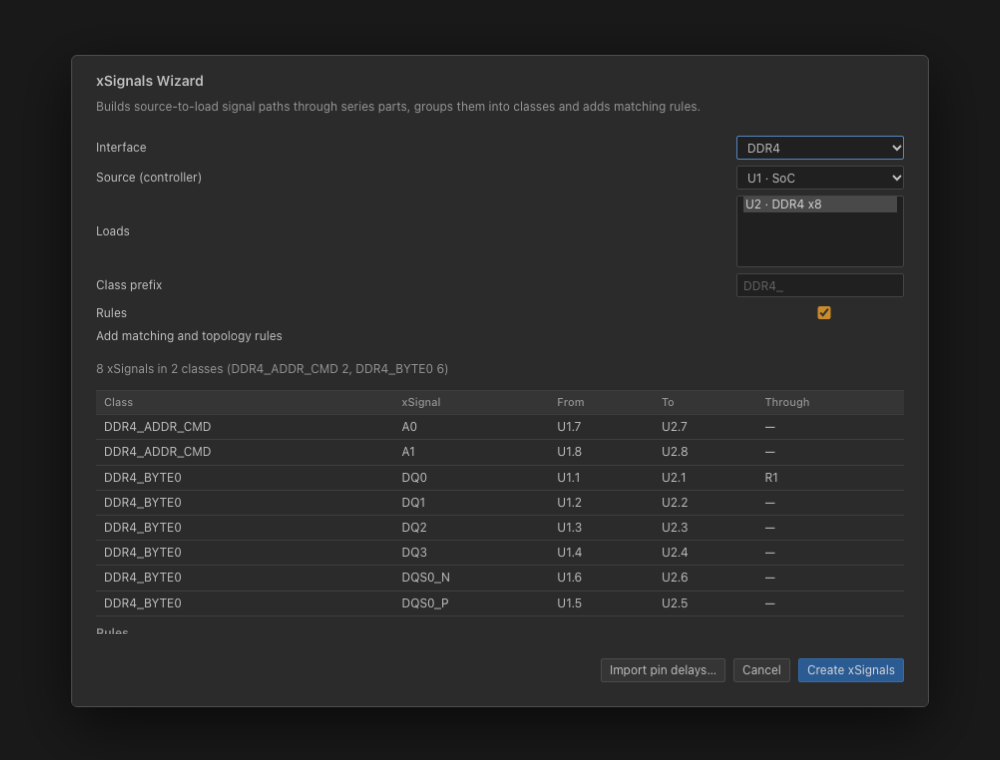
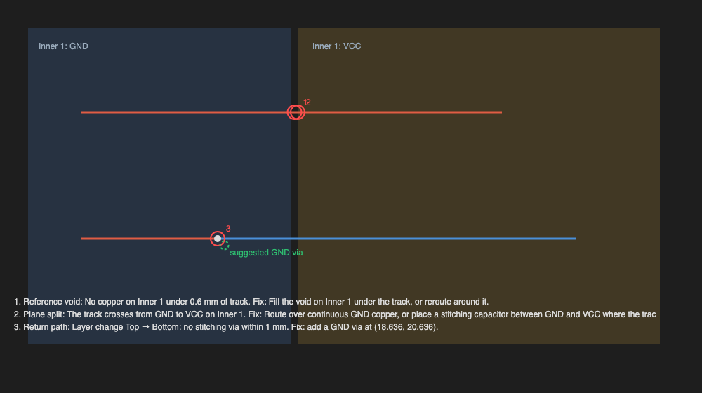
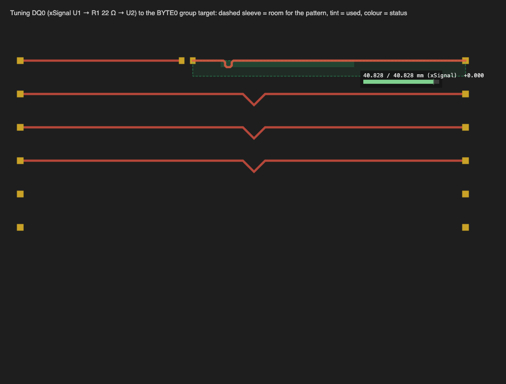

# High-speed design

Waffle's high-speed tools cover stack-up impedance, xSignals, matching in length or time,
routing topology, return paths, crosstalk screening and length tuning. They all work from the
layer stack and the design rules, so the Constraint Manager, DRC, the routers and MCP see the
same constraints.

## Signals and tags

A **net** is connectivity: the pads and copper with one name. A **signal** is what you mean by it:
one net, or several joined by series parts, with a kind (single-ended, differential or bus) and
**tags**. Tags replace net classes, differential pair classes and xSignal classes; rules scope to
signals and tags, and the Altium keywords keep working.

- **Spans.** A signal crosses two-pin series parts (R, C, L, FB, links), resistor-network elements
  and common-mode choke windings whose pins the part's `SeriesPins` parameter names (`1-2,3-4`). An
  AC-coupled PCIe lane is therefore one differential signal of four nets: its pair has one stage
  per side of the capacitors (`PCIE_TX0`, `PCIE_TX0.1`, or the names you give them), and
  `InDifferentialPair('PCIE_TX0')` covers both. A span never crosses into a rail or ground, into
  another signal's own nets, into a net with more than 8 pins, or through a bussed resistor
  network. Only declared signals span; a net nobody declared is its own signal.
- **Polarity, no naming rule.** Each leg of a differential signal is + or −, set when you declare
  it and flipped with one click. Names only produce suggestions (USB_DP/USB_DM, CANH/CANL,
  CK_t/CK_c, TXP0/TXN0 …): accept or decline them in the Signals panel, on the board's right-click
  menu (**Declare Differential Pair**), or while routing one with the differential pair router: the
  status bar offers **Declare pair**. Routing a name match as a pair never declares it.
- **Common-mode chokes.** A 4-pin choke (L, FL, T, CMC) with one pin on each leg of a declared
  differential signal is offered a pin map in the Signals panel's suggestions when its other two nets
  pair up by name. Accepting it lets the signal span the choke (a series override); it is never
  applied by itself.
- **Window › Panels › Signals** lists signals with their legs, nets and the series parts each one
  crosses, tags, suggestions and issues (span conflicts, a stage that does not pair, an assumed
  polarity). New, Make differential, Flip, Tag, Rename, Split at a part, Merge, Remove; each is
  one undo step. On the board, right-click a net: **Show Signal …** opens the panel on its signal,
  **Declare Signal from …** declares one.
- **Design › Constraint Manager** has **Signals** and **Tags** sheets: each row's nets, failing nets
  and length spread, and width, length, match tolerance, clearance and impedance profile constraints
  that edit rules scoped `InSignal('…')` / `HasTag('…')`.
- **Schematic directives.** On a net label, port, power port, off-sheet connector or wire, set
  **Signal**, **Polarity** and **Tags** in Properties. They act on the board at once, as one undoable
  edit (no Update PCB), and show in design diffs. The older Net class and Differential pair
  properties still work. A signal from a directive is read-only in the panel; **Detach** makes it
  a stored one.
- **Rules.** `InSignal('PCIE_TX0')` and `HasTag('PCIe')` in any scope, and the Signal and Tag scope
  kinds in the rules editor. `InNetClass`, `InDifferentialPair`, `InDifferentialPairClass`,
  `InxSignal` and `InxSignalClass` read the same model. The Filter panel has the `Signal` and
  `Polarity` properties (`HasTag('USB') And Polarity = '+'`).
- **Files.** Signals are stored in `project.signals` (format 1.4) once you edit one: it is the only
  store of net classes, pairs, their classes, xSignals and xSignal classes (Altium export writes them
  as classes again). See [format-versioning.md](format-versioning.md).

## xSignals and series terminations

An **xSignal** is a signal path from a source pin to a load pin that may pass through series
parts: a termination resistor, an AC-coupling capacitor, a ferrite or a 0 Ω link. Matching uses
the whole path. Its length is the copper on both nets plus the part's own pad-to-pad length, and
its delay includes that part.

- **Automatic.** A matched net that runs point to point into a two-pin series part, whose other
  net is also point to point, is matched as source pin → part → load pin. You do not need to
  define anything. To turn this off for a board, set `lengthTuning.autoXSignals` to false.
- **Part length.** By default the part counts as its pad-to-pad distance at the outer-layer
  delay. To override it, set `seriesLength` (mm) or `seriesDelay` (ps) on the part. Setting
  `lengthTuning.seriesModel` to `"none"` ignores the part.
- **Design › xSignals Wizard…** builds xSignals between a controller and its loads from the
  netlist, so it works before routing.
  - **Presets:** DDR3, DDR4, DDR5, LPDDR4 and Generic bus.
  - **Classes:** DDR presets group the paths into byte lanes (DQ, the DQS pair, DM/DBI),
    ADDR_CMD and CLK.
  - **Rules:** it adds a Matched Delays rule per class, with pair phase. With several loads, it
    also adds a Fly-by topology rule for the address bus.
  - **Import pin delays…** reads package pin delays from a CSV file. Columns: Designator, Pin,
    and Delay (ps) and/or Length (mm, or mil when the header says so).
- **Rules.** Use `InxSignal('DQ0')` and `InxSignalClass('DDR4_BYTE0')` in any rule scope. Length,
  Propagation Delay, Matched Lengths and Matched Delays rules with these scopes are checked per
  xSignal.

## Matching in time

Matched Delays and Propagation Delay rules work in picoseconds. The delay of each layer comes
from the stack-up: the effective permittivity of microstrip or stripline, from the impedance
models. Each via adds its barrel and pad terms, and imported package pin delays are added too.
The members of a differential pair are timed in odd mode, with the pair's gap (or impedance profile)
from its Differential Pairs Routing rule, so a gap change re-times the pair.
Pairs can be held to a phase tolerance (ps).

### Neck-down and auto-shrink

A track may run narrower than its Width rule, or its impedance profile's window, for a short
**neck-down** at each end, into a pad. There is one neck-down length per end: the Width or
Differential Pairs Routing rule's **Neck-down length per end**, else the impedance profile's neck
length, else 2.5 mm. The interactive router necks down within it, and the impedance checks report a
longer neck. When the differential pair router shrinks a pair to fit (auto-shrink), it stops at the
profile's warn window (by default ±5 %), not at the ±10 % that DRC flags.

## Topology

The Routing Topology rule checks the routed copper for **Daisy-Simple**, **Daisy-MidDriven**,
**Daisy-Balanced**, **Fly-by**, **T-branch** and **Starburst**:

- **Max stub length.** Limits each load's branch off the trunk.
- **Fly-by.** Ends at the terminator: a resistor to VTT or another supply.
- **Branch length tolerance.** Balances the arms of a T or a star.
- **Load order and source.** Set these per net or xSignal class in Design › Constraint
  Manager › xSignals, or with the MCP `topology` tool. By default the source is the part with
  the most pins.

Shortest, Horizontal and Vertical still only steer the ratsnest.

## Return Path

The Return Path rule checks the reference plane under every track in its scope. It reports:

- Voids under the track, and partial overlaps.
- Crossings of a plane split.
- Layer changes where the reference changes. When the reference stays on the same net, a
  stitching via must lie within the distance. When it changes net, a stitching capacitor must
  lie within the capacitor distance.

Each violation says how to fix it. For a missing stitching via, it proposes a free site for a
via of the reference net.

## Parallel Segment

The Parallel Segment rule is a crosstalk screen, not a simulation. Tracks of two scopes may run
parallel, at or below the parallel gap, for at most the parallel limit. The check covers the
same layer, broadside on adjacent layers, or both. It counts each segment pair separately, or
sums the runs per net pair. Tools › Signal Integrity estimates the coupled noise.

## Field solver

The Layer Stack Manager's Impedance tab has a **Field solver** button. It solves each layer of
the selected profile with the 2D quasi-static solver and compares the result with the
closed-form model.

- **Solver.** It is a finite-volume solver: a graded mesh, the exact trapezoid for the etch
  factor, and solder mask as a conformal coat. It runs in a worker.
- **Results.** It returns Z0, Zdiff/Zodd/Zeven, εeff, delay, the C/L/R/G matrices and the
  coupling coefficients.
- **Losses.** Conductor loss can use Hammerstad-Jensen, Groisse or Huray roughness. Dielectric
  loss can use a causal Djordjevic-Sarkar dispersion model.
- **Accuracy.** Within about 1% of exact and reference impedances in the solver’s checks. [Impedance tests](../tests/analysis/impedance.cjs)
- **MCP.** The `field_solve` tool takes any cross-section, or one from the board stack-up.

## Length tuning

Length tuning offers accordion, trombone and sawtooth patterns, pairs that stay coupled, skew
and phase tuning, and auto-tuning of a whole group.

- **Tuning sleeve.** While you drag, a band along the segment shows how much room the pattern
  has. The dashed outline is the room available and the tinted part is the room used. The band
  is blue while short, green within tolerance and red when long.
- **xSignal targets.** Tuning a net that belongs to an xSignal targets the path. The gauge reads
  the whole path length.

## MCP

| Tool | What it does |
|---|---|
| `signals` | `action: "create_from_nets"` creates a differential pair (`kind: "diff"`), bus (`"bus"`) or tagged group (`"tag"`) from existing PCB `nets`. Supply a `name` to label a signal or a `tag` for a tagged group. `mode: "plan"` reads the plan. The default produces a proposal. `mode: "write"` needs a write-enabled server. |
| `xsignals` | `list`, `plan` (the wizard, without writing), `wizard`, `add`, `remove`, `set_class`, `discover` and `import_pin_delays` |
| `topology` | `analyze` reports the routed shape, stubs, branch points and violations; `set_order` stores a custom source and load order |
| `field_solve` | Solves any cross-section, or one from the stack-up (`layer`); `target` synthesizes a width |
| `constraints` | Its `tab: "xsignals"` lists paths with path length, delay, match group and topology |
| `run_drc` | Reports Routing Topology, Parallel Segment, Return Path and xSignal-scoped rules |
