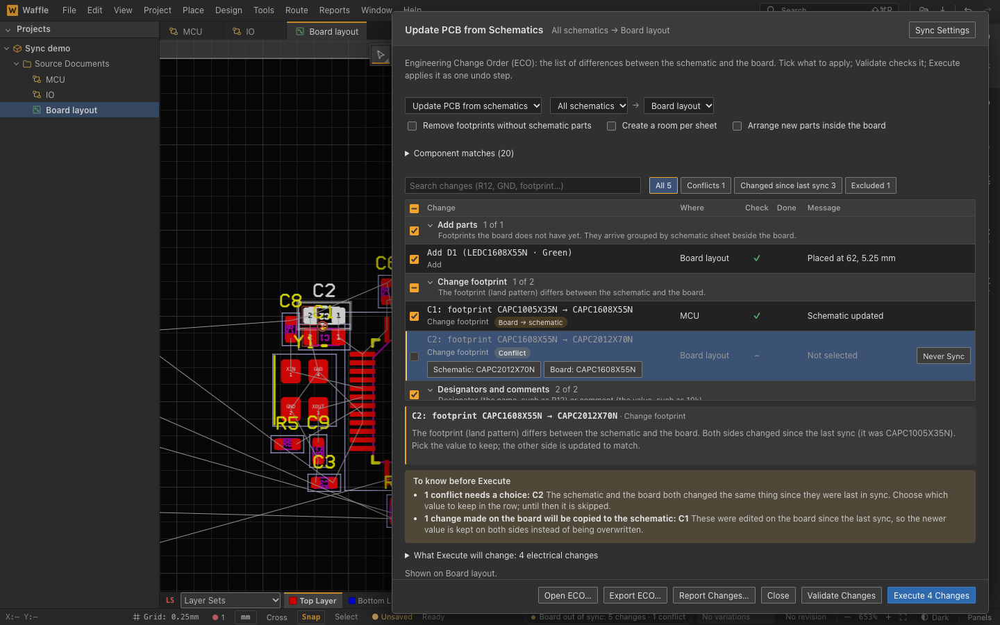
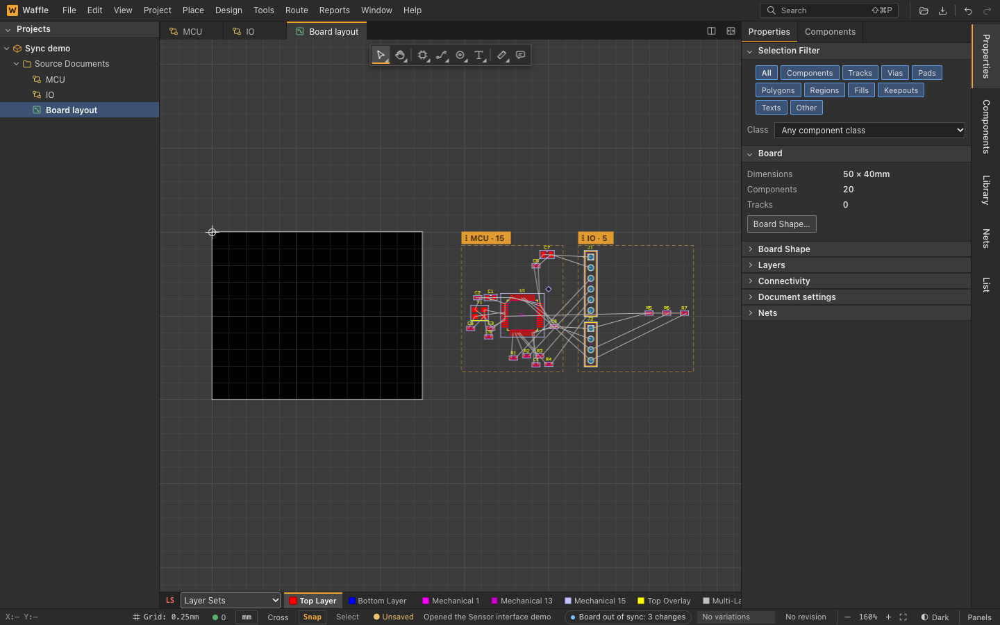
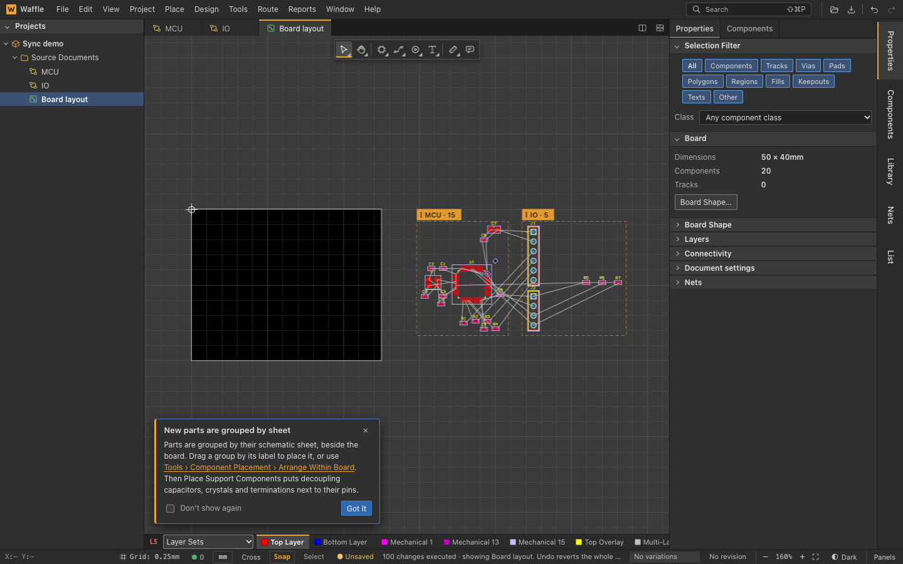
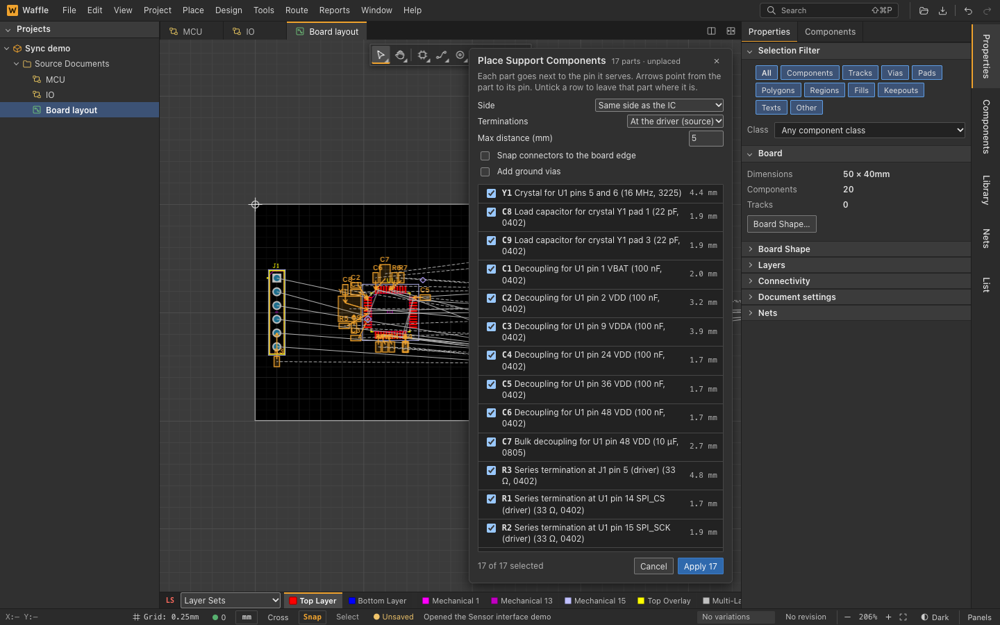

# Schematic ↔ PCB sync and support placement

Waffle keeps the schematic and the board in step the way Altium does: **Design › Update PCB from Schematics** and **Design › Update Schematics from PCB**. Both open one dialog, the Engineering Change Order (ECO): the list of differences, which you tick and then apply.

## The change list

- **Grouped by what changes.** The groups are Add parts, Remove parts, Change footprint, Designators and comments, Parameters, Change nets, Rename nets, Classes, Rules (differential pairs), Rooms, Links, and pin and gate swaps from the board.
  - Each group has a count ("3 of 4") and a checkbox that ticks or unticks the whole group.
- **One plain sentence per row**, for example `R12: footprint 0402 → 0603`, `U1 pin 7: net NRST → RESET` or `Add D1 (0603 · Green)`. The Altium term sits underneath (Change footprint, Pad net, …).
- **Search and filters.** The search box matches designators, nets and terms. The chips show All, Conflicts, Changed since last sync, Excluded, Never sync and Problems.
- **Linked preview.** Click a row and the affected parts are selected and framed on the target canvas, with their net highlighted. The dialog docks to the right so that the canvas stays visible. New parts appear as dashed ghosts where they will arrive. Closing without executing returns you to the document you were on.
- **Never sync this.** Each row has a Never Sync button (it shows on hover). It adds a rule that leaves that difference alone in every later update, for example a footprint you deliberately changed on the board only.
  - **Sync Settings** (the dialog's header button, or **Design › Sync Settings…**) lists the rules. **Sync Again** removes a rule.

## Which side changed: origins and conflicts

After each Execute, Waffle remembers the values that both sides agreed on (designator, comment and footprint per part, stored with the board). At the next comparison it uses them to tell which side each difference came from:

| Row badge | Meaning | Default |
|---|---|---|
| Changed on the schematic | Only the schematic moved away from the agreed value | Applied to the board |
| Board → schematic | Only the board changed (for example, you swapped a footprint while placing) | Copied back to the schematic, even from Update PCB. Nothing newer is overwritten. |
| Conflict | Both sides changed, to different values | Skipped until you pick **Schematic: …** or **Board: …** in the row |

**Sync Settings › Forget Sync History** clears these remembered values. Differences then simply follow the update direction, as in Altium.

## Validate, Execute, report

- **Validate Changes** runs the ticked changes on a copy and explains anything you should know first:
  - conflicts that have no choice yet
  - footprints to be removed that still have routed copper (with a count)
  - removed nets that carry copper
  - changes that will be copied back to the schematic
  - locked parts that are left alone
  - changes that will be skipped because a change they need is unticked

  It also runs the design-diff engine (`AtriumDiff`) on that copy and summarises what Execute will change ("4 electrical changes", with sentences).
- **Execute** validates first. If there are warnings, the button changes to **Execute anyway**. The whole ECO, including any schematic rows, is **one undo step**. Afterwards the report shows what was applied, what failed and why. **Report Changes…** saves it as text.
- **Safety.** Locked footprints are never moved, changed or removed. Routed copper is never moved or deleted by an ECO.

## Status bar: "Board out of sync"

While the schematic and the board differ, the status bar shows **Board out of sync: 3 changes** (with "· 1 conflict" when there is one). When only the board changed, it shows **Schematic out of sync**. Click it to open the matching update.

The check is cheap. When the editor is idle after an edit, Waffle takes a fingerprint of the board's parts (designators, comments, footprints, links, pad nets and parameters, but not positions or copper) and of the schematic sheets. It compares the two designs only when a fingerprint changed, so moving parts and routing never trigger a comparison.

## First import: parts grouped by sheet

- **Arrival.** New footprints arrive in groups, one per schematic sheet (and one per channel of a repeated sheet), beside the board outline. With no outline yet, the groups form a grid.
- **Layout inside a group.** Each group keeps the arrangement of the sheet: parts drawn near each other start near each other, scaled to the footprint sizes and packed without overlaps.
- **Moving a group.** Each group is labelled with its sheet name. Drag the label to move the whole group (one undo step). The label disappears once the group's parts are on the board.
- **Rooms.** **Create a room per sheet** (remembered between sessions) adds a room around each group, as Altium does.
- **Arranging inside the board.** **Arrange new parts inside the board** packs the parts inside the outline instead (off by default).
- **The hint.** A small hint explains the groups the first time. It has a "Don't show again" box. **Sync Settings › Show the Grouping Hint Again** brings it back.

## Place support components

**Tools › Component Placement** has three commands:

| Command | What it places |
|---|---|
| **Place Decoupling** | Decoupling and bulk capacitors |
| **Place Terminations** | Series resistors |
| **Place Support Components** | Everything in the table below |

Each command works on the selection: either support parts, or ICs, whose support parts are then placed. With nothing selected, it works on every support part outside the board. A card lists each part with its role and distance, and the canvas shows a ghost of each new position with an arrow to the pin it serves. You can untick parts and change the side, the termination end or the maximum distance, then **Apply**. The result is one undo step.

How parts are recognised:

| Role | Rule |
|---|---|
| Decoupling | A capacitor below 1 µF between an IC power-pin net and ground. It belongs to the power pin drawn nearest to it on the same sheet. The capacitors of one net are spread over its pins (one per pin before a second one). The smallest value goes closest. |
| Bulk | The same rule at 1 µF and above. It is placed behind the small capacitors of its pin. |
| Crystal | Its two signal pads reach two pins of one IC. It is placed by those pins. |
| Load capacitor | A capacitor from a crystal pad to ground. It is placed beside that pad. |
| Series termination | A two-pin R, C, L or ferrite on two point-to-point nets. It goes at the driver pin by default (an output pin, else an I/O pin, else a connector; never an input), or at the receiver if you choose that. |
| Pull-up / pull-down | A resistor from a signal to a power net or to ground. It is placed by the IC pin on that signal. |
| Connector | Optional: moved to the nearest board edge. |

- **Placement.** A part goes just outside the IC courtyard, on the side of its pin, with the pad on the pin's net facing the pin. With the **Opposite side** option, it goes on the other side, directly behind the pin. For each decoupling capacitor a ground via is suggested beyond its ground pad (**Add ground vias** places them). Locked parts and parts with routed copper are never moved.
- **Explaining and overriding a role.** Select a part: **Properties › Placement role** explains it, for example "Decoupling for U3 pin 12 VDD (100 nF, 0402)". You can change the role, or the pin it serves, or set it to None. These overrides are saved with the board.
- **MCP.** `place_support_components` returns a proposal by default. `mode: "plan"` only reports. `mode: "write"` writes, and needs `--allow-write`.

## Files

- `app/eco.js`, `app/eco.css`: the ECO engine and dialog.
- `app/sync-status.js`, `app/sync.css`: the status indicator, the group labels and the hint.
- `app/support-placement.js`, `app/support-placement.css`: support placement.
- The board stores `board.sync`, with these fields:
  - `base`: the values both sides last agreed on
  - `ignore`: the never-sync rules
  - `clusters`: the arrival groups
  - `support`: role overrides
  - `place`: placement preferences
