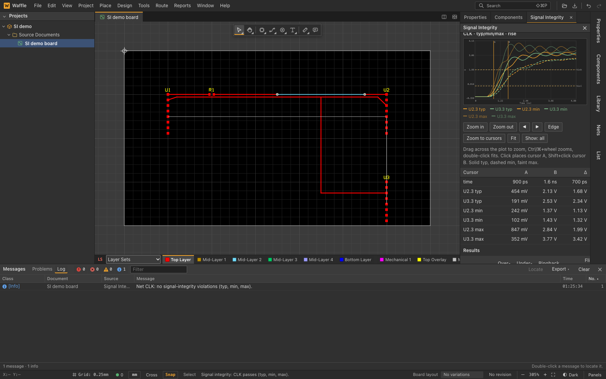
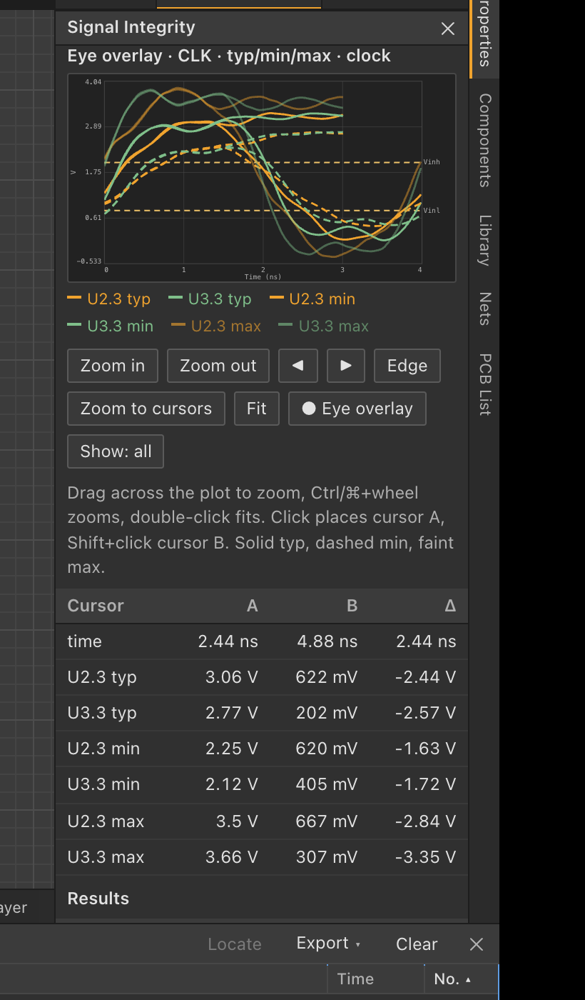

# Signal integrity simulation

The **Signal Integrity** extension simulates reflections and crosstalk on routed nets with IBIS
buffer models. It runs offline in the extension sandbox, and it ships with Waffle.

- The channel follows your routed copper.
- Each segment's impedance, delay and loss come from Waffle's 2D field solver for that segment's
  cross-section.
- The design changes only when you accept a review: storing an IBIS file or assigning a model to a
  part.

## Quick start

1. Open a board and select a track, via or pad of the net.
2. Choose **Tools › Signal Integrity: Simulate Net…** (in the menu's extension group), or run it
   from the command palette.
   - Without a selection, a net picker opens.
3. The **Signal Integrity** panel opens with the waveforms, the results table, crosstalk and the
   channel model. Problems are listed in **Messages**; double-click one to zoom to its part.

Unassigned pins use a generic 3.3 V CMOS buffer (25 Ω, 0.5 ns edge, 2 pF). For real results,
import the part vendors' IBIS files and assign them:

1. **Import IBIS model…** picks an `.ibs` file.
   - The file is checked; a broken file is refused with its line number.
   - It is stored in the project after you accept the review, so it travels with the project.
   - Limits: 8 MB per file, 32 files, 24 MB in total.
2. **Assign model to selected part…** (or *assign…* next to a pin in the panel) chooses the IBIS file
   and component.
   - It also asks for the entry of any `[Model Selector]` the part's pins use.
   - The choice is remembered per part.
3. Simulate again.

## The panel

| Control | What it does |
|---|---|
| Net, Driver | The net, and the driving pin (`auto` takes the first IBIS output or I/O pin) |
| Stimulus | `rise`, `fall`, `pulse` (both edges), or `clock` at the given frequency |
| Typical / Min / Max | The IBIS corners to run: min is slow and weak, max is fast and strong |
| Lossy lines | Conductor and dielectric loss from the field solver at the edge's knee frequency 0.35/tr |
| Crosstalk, Neighbour distance | Other nets' tracks running parallel within this edge-to-edge gap become victims |

**Waveform viewer.**

- **Zoom:**
  - drag across the plot to zoom;
  - Ctrl/⌘ + wheel zooms around the pointer;
  - double-click fits;
  - the buttons zoom, pan, jump to the edge, or zoom to the cursors.
- **Cursors:** click places cursor A and Shift + click places cursor B. The table reads every trace
  at both cursors.
- **Lines:** the dashed lines are the receiver's Vinh and Vinl.
- **Corners** are overlaid: solid is typ, dashed is min, faint is max.
- **Eye overlay** (with the clock stimulus) folds the waveform period by period.
- **Show** cycles between all pins, the receivers only, and each pin alone.
- **Export:** CSV gives every trace at full resolution. PNG gives the plot as shown, at 1200 × 640.

**Results** (per receiver, corner and edge):

- overshoot as a percentage of the swing;
- undershoot below the starting rail;
- ringback margin: the lowest level after the first peak, less Vinh. A negative value re-enters the
  threshold region.
- settling time to within 5 % of the final level;
- flight time to Vinl and to Vinh (the last crossing), measured from the driver's own crossing of
  Vmeas into its IBIS reference load (Rref, Cref, Vref);
- whether the edge is monotonic between Vinl and Vinh.

**Crosstalk** runs on the fastest selected corner:

- each victim's coupled run is simulated as a coupled line pair, with the victim's ends terminated
  in its characteristic impedance;
- it reports the near-end (NEXT) and far-end (FEXT) peaks;
- the closed-form backward coefficient Kb is shown for comparison.

**Termination what-ifs** run on the typ corner:

- **Series R:** sweeps a series resistor at the driver from 0 to 100 Ω.
- **Parallel R:** sweeps a termination to GND at the receivers from 330 to 39 Ω.
- **Best value:** the one with the lowest worst overshoot or undershoot that still crosses the
  thresholds without ringback. The series rule of thumb, first-segment Z0 less the driver's output
  resistance, is shown too.

## What is modelled

| Part of the channel | Model |
|---|---|
| Driver and receiver | IBIS behavioural buffer: `[Pullup]`, `[Pulldown]`, `[GND Clamp]` and `[POWER Clamp]` I-V tables (pullup and power clamp referenced to their supply, as the specification defines), C_comp, and switching coefficients Ku/Kd from two `[Rising/Falling Waveform]` tables (a 2×2 solve per time point), from one (Ku + Kd = 1), or from `[Ramp]` (linear over dV/dt / 0.6). Newton iteration at the buffer nodes. Typ/min/max columns, `[Voltage Range]` and the reference keywords. |
| Package | `[Pin]` R_pin/L_pin/C_pin when given, else `[Package]` R_pkg/L_pkg/C_pkg: series R and L, C at the pin |
| Track segments | Lossless lines by the method of characteristics (Bergeron), with Z0 and delay from the field solver per (layer, width). Reference planes come from the stack-up. Lossy lines are split into up to 6 sections with lumped R and G. A segment shorter than one time step becomes a lumped π section. Collinear segments with one cross-section merge. |
| Vias | Barrel L = 0.2·h·(ln(4h/d)+1) nH and C = 1.41·εr·T·D1/(D2−D1) pF (Johnson and Graham), between the layers the via connects. Stubs beyond them come from the via-stub report, after back-drilling. |
| Series parts | Two-pin R, L, C and ferrite parts between two nets; the channel continues into the next net (up to 4 nets) |
| Shunt parts | R to a rail (the voltage from the net name: GND, +3V3, 1V8, VTT → Vcc/2) and C to ground |
| Crosstalk | Symmetric coupled pair, even and odd modes from the field solver's coupled solve |

The time step is a thirtieth of the fastest edge (0.25 to 20 ps). The stop time covers the edge and
twelve one-way flight times.

## Accuracy

These analytic checks are in `tests/si-sim.cjs`:

| Case | Reference | Error |
|---|---|---|
| Ideal source into a matched line | 0.5 V at both ends, nothing before Td | < 1e-10 |
| Open-ended line | Γ = +1: the receiver doubles to 1.0 V, the driver steps at 2 Td | < 1e-10 |
| Mismatched line (Rs 10 Ω, Z0 50 Ω, RL 200 Ω) | Lattice-diagram plateaus at 1, 3, 5, 7 and 9 Td | < 1e-10 |
| | Overshoot and ringback margin from the lattice | < 1e-9 |
| RC-limited edge (100 Ω, 10 pF) | 10-90 % = RC·ln 9 | 1e-7 |
| Weakly coupled lines (Ze 52 Ω, Zo 48 Ω, ΔTd 10 ps, tr 100 ps) | NEXT = Kb·Vinc | 0.04 % |
| | FEXT = Vinc·ΔTd/(2 tr) | 0.04 % |
| Lossy line, 10 Ω over 100 mm | First arrival 0.5·e^(−R/2Z0) | 0.18 % |
| | DC level | 1e-9 |
| IBIS buffer into its own V-t fixtures, at all corners and both fixtures | The file's waveforms | ≤ 2.3 mV |
| Ku/Kd recovered from two waveforms | The ramp the test file was made with | ≤ 1.1 % |

**Optional ngspice check.** `python3 tests/si-ngspice.py` compares a mismatched, capacitively loaded
line with ngspice when `ngspice` is on PATH. It skips otherwise.

**Field solver.** The [field solver](high-speed.md#field-solver) is accurate to about 0.3% on Z0 and
6 % on conductor loss.

## Limits

- **Coupled runs:**
  - Coupling is edge-coupled on the same layer only; broadside coupling is not modelled.
  - Each victim is simulated alone, as one coupled run at the aggressor's longest parallel segment,
    covering the total coupled length up to that segment's length.
  - Coupled runs are lossless.
- **Not modelled:**
  - plane voids and split crossings (the nominal reference planes from the stack-up are used; SI-lite,
    Tools › Signal Integrity…, checks those);
  - bends;
  - frequency-dependent loss beyond the knee frequency;
  - differential IBIS models;
  - `[Driver Schedule]`, `[Submodel]`, package models, EBD, and IBIS-AMI.

  These keywords are skipped with a note.
- **Fixture parasitics:** C_fixture, L_fixture and the DUT parasitics of IBIS waveforms are ignored,
  with a warning.

## Automation

- **Programmatic command.** `si.simulate` takes `{net, driver, corners, stimulus, freq, loss,
  crosstalk, gap, sweep, waves}` and returns the metrics as JSON.
- **MCP.** The MCP tool `si_simulate` runs the same engine headless, without the extension worker:
  - It uses the same read-only `simulation.*` calls and the field solver directly.
  - It reads models and assignments from the project.
  - It is read-only.
- **Extension API.** The extension uses these read-only calls, and any extension can:
  - `api.simulation.channel`, `api.simulation.fieldSolve`, `api.simulation.get` and
    `api.simulation.model`;
  - `api.files.pickText`.

  See the [API reference](extension-api.md#simulation).

## Security

- **Sandbox.** The extension declares `read:project`, `propose:edits`, `outputs:write`, `ui:panel`
  and `ui:command`. It has no network access and no `write:edits`.
- **Files.** It reads files only through `files.pickText`, the system picker, which is size-capped and
  shown as one dialog at a time.
- **IBIS parsing.** IBIS text is treated as untrusted:
  - no evaluation;
  - linear-time regular expressions;
  - names kept in Maps;
  - limits on lines, line length, rows, models, pins and waveforms.
- **Stored data.** Stored models live in `project.simulation`. That field holds no code, and every
  change to it is a reviewed proposal.
