# UI library

Build all Waffle UI from these components. Do not create your own controls. If a component is missing, add it here, to the gallery and to the lint in the same change. The [design system](design-system.md) defines the tokens, the motion rules and the native-behaviour policies used by these components.

| Part | Where |
| --- | --- |
| Form controls, tabs, segmented controls, dialogs, popovers, select lists | [`app/ui/controls.css`](../app/ui/controls.css) (eager) |
| Every other family | [`app/ui/components.css`](../app/ui/components.css) (eager) |
| Builders that add roles, state and keys | [`app/ui/kit.js`](../app/ui/kit.js): `await AtriumLazy.need("AtriumUIKit")` (lazy) |
| Dialogs | `AtriumShell.dialog`, `adoptDialog`, `openDialog` ([`app/ui/dialog.js`](../app/ui/dialog.js)) |
| Dropdown lists | native `<select>`; [`ui/select-popup.js`](../app/ui/select-popup.js) opens every one |
| Menus | `AtriumContextMenu.popup`, `.dropdown`; `AtriumNavCommon.actionMenu` |
| Tooltips and hover cards | `title` or `data-tooltip`; [`ui/tooltip.js`](../app/ui/tooltip.js) |
| Keycaps | `AtriumShortcut.render(binding, {variant})` ([`ui/shortcut.js`](../app/ui/shortcut.js)) |
| Toasts | `AtriumToast.show(text, {kind})` |
| Living gallery | `app/index.html#ui-gallery` or the `ui-gallery` action ([`ui/gallery.js`](../app/ui/gallery.js)) |
| Lint | `python3 -B tests/ui-library-lint.py` |
| Regression tests | `node tests/browser-ui-gallery.cjs` (the gallery) · `node tests/browser-ui-snapshots.cjs` (before and after a migration) |
| Where each family is still built ad hoc | [UI inventory](ui-inventory.md) (`python3 scripts/ui-inventory.py --write`) |

## Settled rules

The user has approved these rules. A change to any of them needs the user's approval.

- One face for each control family. The library owns the face. A feature stylesheet can place and size a component, but it does not repaint it.
- Buttons use a soft fill with no outline. The high-contrast themes keep outlines. Primary buttons use `--primary`, and only the default action in a row is primary.
- Do not put a box inside another box. Group content with headings and hairlines. Put the actions for a group on its heading row.
- Dialogs are compact rows, like Altium's Output Job dialog. Do not use large cards or extra subtitles.
- The app uses one accent colour, `--accent`. Status uses status tones, not more accents.
- Chrome is drawn on whole pixels (`AtriumWorkbench.wholePixels`, `round()` in CSS).
- The app must not behave like a web page. Focus rings show only during keyboard navigation (`html[data-focus-nav=keys]`). Only real links use `cursor:pointer`. Chrome never uses `cursor:grab`. Chrome text is not selectable. The page cannot zoom or overscroll. See [Native behaviour](design-system.md#native-behaviour).
- Every dropdown opens through `AtriumSelectPopup`.
- Switches animate over `--motion-toggle`.
- Dialogs stay inside the window's safe area. Nothing but a title-bar row draws under the macOS title bar or beside the Windows window controls (see [Window safe area](#window-safe-area)).
- Keycaps come from one shared renderer, and Escape shows as "esc" on the Mac.
- Hover cards are small, never block content and close when the camera moves.
- Touch behaves the same at every density. Touch targets reach 44 px through hit areas, so the visible control can stay compact.
- Icons on icon buttons draw in `--ink`, one icon ink everywhere (2026-11-23). `.tool` and `.ui-icon-button` share the library hover fill, `--button-face-hover`.
- A banner over the canvas is a floating notice (`.ui-notice[data-floating]`): a solid surface under the tone's tint, at `--elev-2`.
- A data colour reaches the page through `--swatch`, never through a face set from script.
- `.ui-tabs[data-strip]` is the standard tab strip for a panel's or a dialog's views.
- A match count lives in its search field (`.ui-search-count`), not in the heading.
- Scrolling never changes layout width (2026-11-23, the user's request). No native scrollbar takes space or paints a track; `ui/overlay-scroll.js` draws a thin overlay thumb on the edge of what scrolls, as on the Mac, while it scrolls or while a mouse or pen is at that edge. Do not set `scrollbar-width` or `scrollbar-gutter` in feature CSS.
- A panel header's buttons and their icons sit on the title row's centre line. `.ui-button` centres its content when a feature lays it out as flex.
- The [settled faces](#settled-faces) keep their approved appearance.

## Using the library

**Markup.** Static markup uses the classes below. Library rules have the specificity of one class. A feature class with a context selector, such as `.my-panel .ui-chip {margin…}`, can place a component. Do not reset or repaint the component's face.

**Builders.** `AtriumUIKit` is lazy, so load it before calling a builder:

```js
const K = await AtriumLazy.need("AtriumUIKit");
panel.append(K.section("Links", {actions:[K.iconButton("plus", "Add link", {run:add})]},
  K.row({title:"Datasheet p. 12", icon:"book", detail:"Rev C", meta:"PDF"})));
```

Eager modules have only a few hundred bytes of startup headroom (`tests/startup-budget.py`). They should use the classes directly or load the kit on first use.

**States.** Use the native or ARIA state attributes: `disabled`, `aria-pressed`, `aria-selected`, `aria-current`, `aria-expanded`, `aria-invalid` and `data-state`. They carry both the appearance and the meaning. Do not add `is-active` or `is-selected` classes.

**Tones.** `data-tone="info|success|warning|danger|accent"` works on badges, counts, dots, notices, status lines and steps. Leave it out for neutral.

**Data colours.** A swatch whose colour is the content (a net, a layer, a theme token, an authored table or text colour) sets the `--swatch` custom property, not `.style.background`: `node.style.setProperty("--swatch", colour)`. The library paints `background:var(--swatch)` on any element that sets it, with the precedence an inline style had, so feature rules for a pressed or empty state still win only where they did before. A feature rule may also read `var(--swatch)` itself. The lint accepts custom properties and `var(--swatch)` and rejects every other face set from script.

**Menu buttons.** A button that opens a menu opens it through `AtriumContextMenu.dropdown(button, entries)` or `AtriumNavCommon.actionMenu(button, commands)`. The helper sets `aria-haspopup` and `aria-expanded`, and the menu toggles: a second press or tap on the button closes it and it stays closed, also in WebKit, where a pressed button takes no focus. Escape closes it and returns focus to the button, and a press on another menu button switches menus. `tests/ui-library-lint.py` (menu) rejects a menu button that opens some other way, and `tests/browser-menu-toggle.js` presses every menu button twice with the mouse and with touch.

**Touch.** `@media (any-pointer:coarse)` raises the hit areas of rows, chips, splitters, checkboxes and radio buttons. `:root[data-pointer=touch]` turns off hover-only effects. The same scheme applies at every density.

## Components

The user approved every family as the gallery shows it (2026-11-23), including the badge, notice, progress, row, thumbnail, step, transcript, drop-target and splitter families. Each entry describes when to use the component, its markup or builder, its states and the tokens it uses. The images come from the gallery in the light theme. `node tests/browser-ui-gallery.cjs --docs` regenerates them. Open `app/index.html#ui-gallery` to see every state in light, dark and touch.

<a id="button"></a>
### Buttons

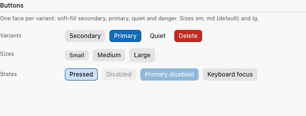

- **Use** for an action. A dialog has one primary action, its default. Use `quiet` for actions on a toolbar or heading row and `danger` for destructive actions.
- **Markup** `<button class="ui-button" data-variant="secondary|primary|quiet|danger" data-size="sm|md|lg">`. `AtriumUI.button(node, variant, size)` adopts an existing button. `AtriumUI.nativeButton(label, onClick, className, title, options)` constructs one before the kit loads. The kit’s `K.button(label, {variant, size, run, pressed, disabled})` uses the same constructor.
- **States** hover, active, `disabled` (45 % opacity), `aria-pressed=true` (selection fill and accent edge), keyboard focus (2 px inset ring; `--on-primary` on primary). On touch, height is `--ctl-h-touch`.
- **Hover** changes the fill and keeps the resting border colour. The secondary hover fill uses 16% ink in standard themes. Primary, danger and selected secondary buttons deepen the effect while held. Custom theme fills can lighten to keep the change visible and the label readable. The gallery requires at least a 1.12:1 contrast step between the resting and hovered fills. Hover and press use `--motion-instant`.
- **Tokens** `--button-face*`, `--button-secondary-hover`, `--primary`, `--on-primary`, `--danger-fill`, `--on-danger`, `--chrome-control-radius`, `--ctl-h*`, `--ctl-px`, `--fw-medium`.
- **Primary ink** is white, as on a macOS default button: the theme darkens the accent fill until white reads at 4.5:1 (`AtriumTheme.derive`). Only a light hue (yellow, mint) that would turn muddy keeps dark ink. `tests/browser-appbar-contrast.js` checks every app-bar button and the Share dialog in every theme.
- **Do** keep labels short and in sentence case, ending with "…" when more input follows. **Don't** draw grey outlined buttons, use a second primary or set button colours in feature CSS.

<a id="icon-button"></a>
### Icon buttons

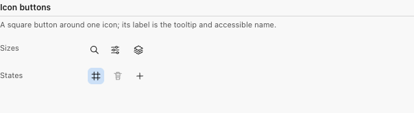

- **Use** for a toolbar, heading or row action with a well-known icon from the `index.html` icon bank.
- **Markup** `<button class="ui-icon-button" aria-label="Add" title="Add"><svg class="icon"><use href="#i-plus"/></svg></button>`, or `K.iconButton(name, label, {size, run, pressed})`.
- **States** hover (soft fill, mouse and pen only), `aria-pressed`/`aria-expanded` (selection fill), `disabled`, keyboard focus. Sizes are `sm` 20, `md` 24 and `lg` 28 px. The icon stays 16 px.
- **Tokens** `--ink` (one icon ink, as in the Projects panel), `--button-face-hover`, `--button-face-pressed`, `--selection`, `--chrome-control-radius`.
- **Do** give every icon button a label. The label also supplies the tooltip. **Don't** use a text glyph (×, ⋯, ▸) as the icon. Close buttons use `.ui-close`.
- The older `.tool` class (extension tools and other canvas chrome) has the same 24 px size and 6 px radius and the same hover fill, `--button-face-hover`. The canvas Active Bar keeps its own 28 px tools and takes that hover fill too.

<a id="close"></a>
### Close button

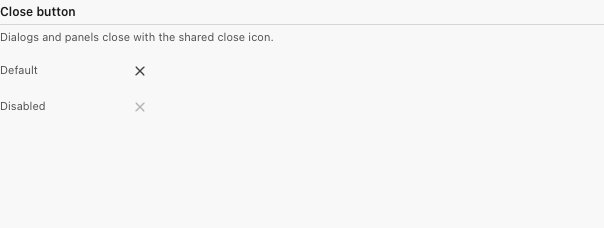

- **Use** to close a panel or a dialog that has no footer. If a dialog has a footer, put Close there and let Escape close it too.
- **Markup** `<button class="ui-close" aria-label="Close">×</button>`, or `K.closeButton(run, label)`. The "×" stays in the DOM for assistive technology, and the icon is drawn with `--icon-close`. A feature class beside `.ui-close` sets only its hit size and position.
- `.ui-chrome-action` is the settled face in editor tab and floating dock headings. Tab and inline dismiss controls reuse the same close symbol with `.ui-dismiss-glyph` and may opt into its smaller glyph.
- **States** hover (`--hover` fill, ink), disabled.
- **Tokens** `--icon-close`, `--icon-ink`, `--ctl-h`, `--r-sm`.

<a id="field"></a>
### Text and number fields

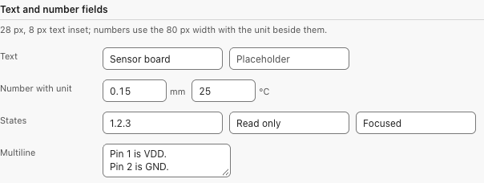

- **Use** for typed values. Numbers use the 80 px number width and show their unit beside the field.
- **Markup** `<input class="ui-field">`, `<textarea class="ui-field">`, number with unit: `<span class="ui-field-measure"><input class="ui-field" type="number"><span class="ui-field-unit">mm</span></span>`. `K.field({type, value, unit, invalid, disabled, onInput})`. Inside adopted dialogs, popovers and the inspector, plain inputs get the same face.
- **States** placeholder, `disabled`, `aria-invalid=true` or `:user-invalid` (`--error` border), focus (fields always show their ring, as native fields do). The field stays 28 px on touch. A Link URL on editing artwork uses the native paper field face, `data-field-face="paper"`. The row label is the hit target. A rejected edit uses `data-edit-rejected` for its error border, or `data-edit-rejected="ink"` for the border and value ink used in the Library. The field’s numeric validation keeps its own `aria-invalid` state.
- **Stepper commands** use `.ui-stepper-button` with the quiet button face. The square leading hairline separates the command from its number field in either text direction.
- **Matrix values** use `.ui-field-number[data-value-source]` for compact clearance cells. `inherited` shows the faint fallback, `authored` marks a stored constraint, and `override` marks a per-object rule override.
- **Tokens** `--field`, `--input-line`, `--field-height`, `--field-number-width`, `--fs-12`.
- **Do** use a native `<label>` or `aria-label`, and keep the caption, value and unit on one baseline. **Don't** turn on spelling or autocorrect in single-line fields. `shell.js` turns them off.

<a id="select"></a>
### Selects

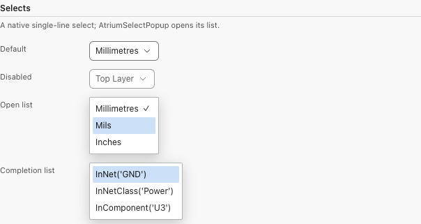

- **Use** to choose one of six or more options, or options whose labels are long. Use a segmented control for two to five short modes.
- **Markup** a native single-line `<select class="ui-field">`, or `K.select(options, {value, onChange})`. `ui/dialog.js` routes presses and keys to `AtriumSelectPopup`, which draws `.ui-select-list` with `.ui-select-option` rows. Do not build your own option list. A completion list, such as query, math or rich-text suggestions, reuses `.ui-select-list[data-completion]` and `.ui-select-option`. In a completion list, `aria-selected` marks the active suggestion. It takes the active fill and shows no ✓.
- **States** `disabled`, the open list (`.active` row, ✓ on the chosen row), RTL chevron.
- **Tokens** `--menu-bg`, `--selection`, `--elev-2`.

<a id="switch"></a>
### Switches

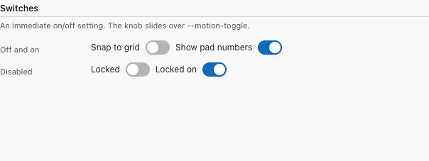

- **Use** for a setting that applies immediately. Use a checkbox for a choice that is applied with a form.
- **Markup** `<label class="ui-switch-row"><span>Snap to grid</span><input class="ui-switch" type="checkbox" role="switch"></label>`, or `K.switchRow(label, {checked, onChange})`.
- **States** off, on (`--primary` track), `disabled`. The knob slides over `--motion-toggle`. With Reduced or Off, the switch changes at once.

<a id="checkbox"></a>
### Checkboxes

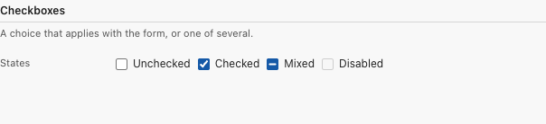

- **Markup** `<label class="ui-checkbox-row"><input class="ui-checkbox" type="checkbox"><span>Label</span></label>`, or `K.checkbox(label, {checked, indeterminate})`.
- **States** checked, indeterminate, `disabled`, keyboard focus. The row is 44 px high on touch.

<a id="radio"></a>
### Radio buttons

The `.ui-choice` label paints checked borders or halos around its native radio. The tinted variant also paints selection in the start and recovery choices. Use `.ui-choice-focus` when keyboard focus needs an outline around the card.

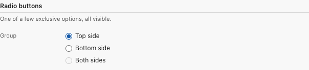

- **Use** for two to five exclusive options that need a sentence each. Use a segmented control when the labels are short.
- **Markup** `<fieldset class="ui-radio-group"><label class="ui-radio-row"><input class="ui-radio" type="radio" name="side"><span>Top side</span></label>…</fieldset>`, or `K.radioGroup(options, {value, onChange})`.

- **Canvas choices** use `.ui-choice.ui-choice-tinted` on a native button. Markers add `.ui-choice-marker` and use `role=radio` and `aria-checked`. Touch modifiers use `data-size=touch` and `aria-pressed`. Their caller owns selection and grouping.

<a id="segmented"></a>
### Segmented controls

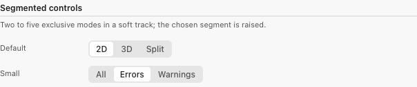

- **Use** for two to five exclusive modes or filters.
- **Markup** `.ui-segmented` around `.ui-segment` buttons with `aria-pressed`, or around labels that wrap native radio buttons. `K.segmented(options, {value, onChange, size})`. Arrow keys, Home and End move through the segments (`ui/dialog.js`).
- **States** a soft track with the chosen segment raised (`light-dark(--field, --raised)`), hover, disabled, keyboard focus. High contrast keeps outlined segments.

<a id="tabs"></a>
### Tabs

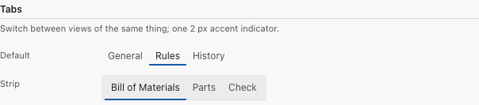

- **Use** to switch between views of the same object. Do not use tabs for steps in a process.
- **Markup** `.ui-tabs[role=tablist]` containing `.ui-tab[role=tab]` with `aria-selected` and a roving `tabindex`. Use `.ui-tab-wrap` when a tab has a close button. `K.tabs(items, {value, onChange})`.
- **States** selected (ink and one 2 px `--accent` indicator), hover, keyboard focus.
- **Underlined** `data-underline` on `.ui-tabs` shares the existing unfilled hairline band used for result tabs and the Symbol Editor.
- **Strip** `data-strip` on `.ui-tabs` (`K.tabs(items, {strip:true})`) puts the tabs on a `--panel-head` band with a hairline under it. It is the standard tab strip (approved 2026-11-23): use it for a panel's or a dialog's view switcher. The band is 32 px (`--chrome-tab-height`), and it scrolls sideways when the tabs overflow. A feature does not paint its own band.
- **Editor strip** `.ui-editor-tab-strip` gives document, split and Dock tabs their shared alignment, height and scrolling. The `data-tab-strip` mode retains the original fills and divider. `.ui-document-tab` supplies the document selection and hover.
- **Boxed** `data-boxed` keeps the settled compact tab face in existing editable grids such as Bill of Materials and Constraint Manager. It uses the same tab controls and keys.

<a id="chip"></a>
### Chips

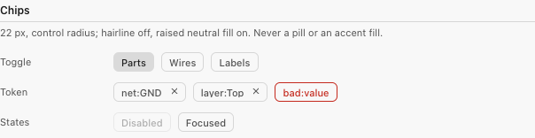

- **Use** for filter toggles, scope tokens and selected values in a query or picker.
- **Markup** toggle: `<button class="ui-chip" aria-pressed="false">Wires</button>`. Token: `<span class="ui-chip"><span class="ui-chip-label">net:GND</span><button class="ui-chip-remove" aria-label="Remove net:GND">×</button></span>`. Group: `.ui-chips`. `K.chip(label, {pressed, onToggle, onRemove, invalid})`.
- **States** off (hairline `--line`, `--muted` text), on (`--raised` fill, no border, ink), hover (mouse and pen, soft fill for either toggle state), `disabled`, `data-invalid` (`--error`), keyboard focus (2 px accent outline). On touch the hit area grows by 2 px on each side.
- **Size** `--chrome-pill-height` (22 px), `--chrome-control-radius`, `--fs-11`, `--fw-medium`.
- **Don't** use pill chips, accent fills or tinted chips. A status label is a badge, not a chip.

<a id="badge"></a>
### Badges, counts and dots

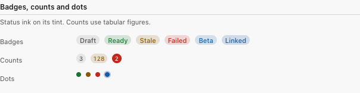

- **Use** a badge for a state label (Draft, Stale, Offline), a count beside a label or tab, and a dot for a live or connection state beside text.
- **Markup** `<span class="ui-badge" data-tone="warning">Stale</span>`, `<span class="ui-count">12</span>` (`data-tone="danger" data-strong` gives the solid red count), `<span class="ui-dot" data-tone="success" data-pulse>` (`data-pulse` adds a still halo for a live state; `data-tone="insight"` is the Design Insights violet for hint-tier problems). `K.badge(text, tone)`, `K.count(n, {tone, strong})`, `K.dot(tone, {pulse, label})`.
- **Tokens** status ink on its tint (`--success` on `--tint-success`, and so on), `--r-pill`, `--fs-11` (`--fs-10` for counts).
- **Outline** `.ui-badge[data-outline]` is the compact outline label for fabrication profiles. In a selected row it follows the row's selection ink.
- **Don't** use a badge as a button.

<a id="avatar"></a>
### Avatars

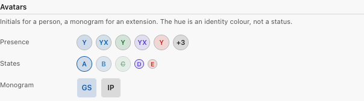

- **Use** for a person's initials in collaboration presence and for an extension's monogram. An avatar is an identity, not a status: use a badge or a dot for state.
- **Markup** `<span class="ui-avatar" data-hue="2" role="img" aria-label="Ada has this open">A</span>`, or `K.avatar(text, {hue, size, shape, state, label})`. `data-hue` 0–4 gives ink on its tint (accent, info, success, insight, danger); pick it from a stable hash of the person's or extension's id. Without a hue the avatar is neutral (`--raised`).
- **Sizes** 24 px by default, `data-size=sm` 14 px (beside a document row), `data-size=lg` 32 px (an extension card). Round with a hairline `--line-strong` ring; `data-shape=square` is a monogram with `--r-md` corners and no ring.
- **States** `data-state=active` rings it in its own ink (editing), `away` fades it (viewing), `stale` fades and strikes it (a lock left behind).
- **Tokens** `--raised`, `--line-strong`, `--tint-*`, `--r-pill`, `--r-md`, `--fw-semibold`.

<a id="overlay-label"></a>
### Overlay labels

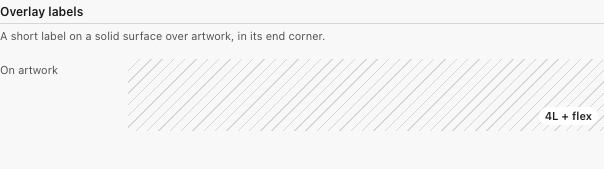

- **Use** for a short label drawn over artwork, such as a template's layer count on its thumbnail.
- **Markup** `<span class="ui-overlay-label">4L + flex</span>` inside the positioned artwork box, or `K.overlayLabel(text)`. It sits 6 px in from the artwork's end corner, on the solid floating surface `--overlay` so it reads over any drawing, and it ignores the pointer.
- **Tokens** `--overlay`, `--ink`, `--r-pill`, `--fs-11`, `--fw-semibold`.
- **Don't** use it for a status; a state on a list row is a badge. An artwork close button uses the same solid face through `.ui-close[data-fill=overlay]`.

<a id="search"></a>
### Search fields

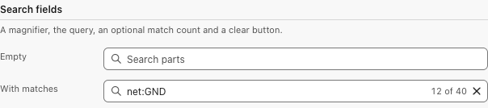

- **Use** to filter a list or to find text in a panel. The command palette has its own larger search bar.
- **Markup** `.ui-search` containing `svg.icon` (search), `input.ui-field[type=search]`, `.ui-search-count` and a `.ui-icon-button.ui-search-clear`. Build one with `K.search({placeholder, label, value, count, onInput})`. To build the shell before the kit loads, use `AtriumUI.searchField(input, {cls, type, accessory})`. To upgrade an input that is already in static markup, use `K.adoptSearch(input, {label, count, onInput})`. It wraps the input in place, or keeps its `.ui-search` parent, and adds the magnifier, the clear button and the count. Both return the wrapper, with `.input` and `.setCount(text)`. An empty text hides the count. Escape clears the field first, then closes its surface.
- **States** empty (no clear button), with text, match count (`aria-live`; the query never runs under it), no matches. Show the no-match message as an empty state in the list. Put a count wherever results are counted, such as "12 of 40" or "3". The count goes in the field, never in the panel heading: put a static `span.ui-search-count` in the `.ui-search` markup and set it with `.setCount` once the kit has adopted the field (Nets, Navigator and Signals do this).

<a id="keycap"></a>
### Keycaps and shortcuts

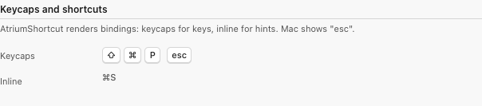

- **Markup** `AtriumShortcut.render(binding, {variant:"keycap"|"inline"})`. Take the binding from the keyboard map. Do not type it out. The Mac shows "esc", ⌘ and ⇧ glyphs, and other platforms show words. The style check rejects raw keycap markup.

<a id="section"></a>
### Section headers

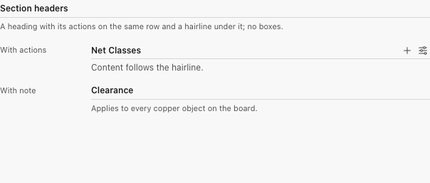

- **Use** to group content in panels, inspectors, dialogs and settings.
- **Markup** `<section class="ui-section"><div class="ui-section-head"><h3 class="ui-section-title">Net Classes</h3><div class="ui-section-actions">…</div></div>…</section>`, optional `.ui-section-note`. `K.section(title, {actions, note, quiet}, ...content)`. `data-quiet` removes the hairline when a property list follows.
- **Tokens** `--fw-semibold`, `--fs-12`, `--head-ink`, `--line`.
- **Don't** put the section in a bordered card, and don't put its actions in a separate row.

<a id="prop-row"></a>
### Property rows

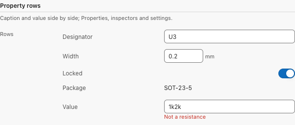

- **Use** for a caption and a value or control in Properties, inspectors and compact settings.
- **Markup** `<label class="ui-prop-row"><span>Width</span><input class="ui-field"></label>`. Read-only values use `<span class="ui-prop-value ui-selectable">`, and an error uses `.ui-prop-error`. `K.propRow(caption, control|text, {error, stacked})`. The caption takes 42 % (`--ui-prop-label`). In `data-stacked` rows the caption sits above the value.
- **States** read-only text, editable, invalid (with its message under the value), and a switch or checkbox aligned to the end. Rows are 44 px high on touch.
- The PCB and schematic Properties panel uses its existing `#inspector .field-row` rows, which follow the same rules.

<a id="row"></a>
### List and tree rows

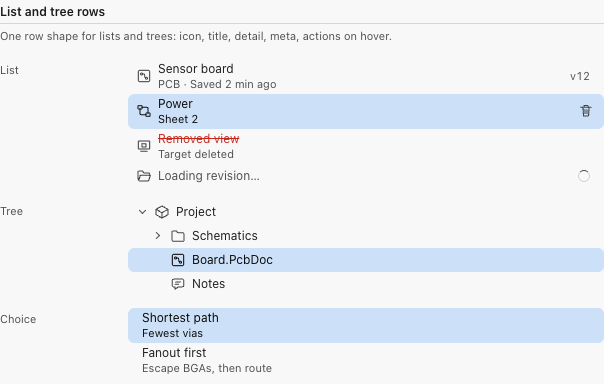

- **Use** for every list of documents, results, links, history entries, windows, saved views, macros and similar items.
- **Markup** `.ui-row` (grid: `.ui-row-icon`, `.ui-row-text` > `.ui-row-title` + `.ui-row-detail`, `.ui-row-meta`, `.ui-row-actions[data-reveal]`). A tree row adds `.ui-tree-row`, a leading `.ui-disclosure`, `aria-expanded` and `--ui-depth`. Put rows in `.ui-list[role=listbox|tree]`. `K.row({title, detail, icon, meta, actions, selected, current, depth, expanded, state, run})`, `K.list(rows, {role})`.
- **States** hover (mouse and pen), `aria-selected`/`aria-current`/`aria-pressed` (selection fill), `aria-checked=true` for a radio-like choice (`role=radio` rows in a `role=radiogroup` list, `K.row({checked})`; selection fill), `disabled`, `data-state="broken"` (error ink, struck through), `data-state="pending"` (muted, with a spinner as its meta), and actions that appear on hover or focus and always show on touch. Rows are 24 px high and 28 px on touch.
- **Tokens** `--chrome-row-height`, `--hover`, `--selection`, `--selection-ink`, `--chrome-control-radius`.
- **Flush lists** use `.ui-list[data-layout=flush]` for full-width rows whose metadata or graph needs a feature-defined layout. The default row is a flex line. The library draws the selection and hover and gives a focusable list its inset focus outline.
- **Illustrated rows** use `.ui-card-row` inside a flush list. `data-select-on-focus` keeps the border on the chosen card and draws the selection fill only when the list has focus, as in the Clipboard panel and picker.
- The Projects tree shares selection and hover with list rows. Its `.ui-project-row` keeps the settled document, disclosure and collaboration columns.
- **Stacked lists** use `.ui-list[data-layout=stacked]` with `.ui-row-subtitle` for the second line. Existing compact lists may set `--ui-row-pad`, `--ui-row-hover`, `--ui-row-marker` and `--ui-row-selected-meta`. Use `data-row-focus` for an inset ring on individually focusable rows.
- A framed native disclosure uses `.ui-disclosure-card` on its summary. It shares the inset card outline with a 44 px native hit target.
- A disclosure in a flex heading uses `.ui-disclosure-marker` on the native summary or on the toggle button with `aria-expanded`. It uses the same chevron as tree rows.
- **Do** keep the selection and focus on stable IDs when a list refreshes. Page long lists through `AtriumWindowedTable` or a "Show more" row.

<a id="table"></a>
### Tables

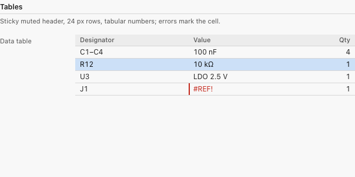

- **Use** `.ui-table` for a read-only list with columns. The editable grids, such as Bill of Materials and Constraint Manager, share [`ui/spreadsheet.css`](../app/ui/spreadsheet.css) under `.ui-dialog[data-grid]`. Tables with inline pin editors use `.ui-sheet-fields`. Add `data-checkbox-cells` when checkboxes occupy the full cell. Large tables use `AtriumWindowedTable`.
- **Cell editor** an active `.ui-field[data-grid-editing]` fills its cell and draws the focus border. The grid owns the editing and commit policy.
- **Severity editing** Put `data-severity="none|warning|error|fatal"` on a matrix button with `.ui-severity-cell`, a select with `.ui-severity-field`, or a legend swatch with `.ui-severity-swatch`. Use the severity name in the control's accessible label.
- **Analysis results** Use `K.analysisTable(columns, rows, renderRow, {wrapClass, tableClass, empty, emptyClass})` for scoped headers and a full-width empty state. Keep result limits and row actions in the caller.
- **Markup** `<table class="ui-table">`. The sticky `thead th` uses `--panel-head`, muted `--fs-11` and `--fw-medium`. Use `td.is-number` for numbers, `tr[aria-selected=true]` for a selected row, `td[data-state=error]` (an error bar at the start of the cell) and `td[data-state=stale]`.
- **Do** attach an error to the affected cell and keep the authored value visible.

<a id="toolbar"></a>
### Toolbars

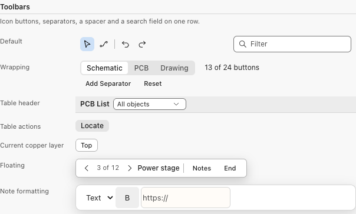

- **Markup** `.ui-toolbar[role=toolbar]` with icon buttons, quiet buttons, `.ui-toolbar-sep`, `.ui-toolbar-spacer` and a search field. `K.toolbar(items)`, where `"|"` is a separator and `"->"` is a spacer.
- **Note formatting** `K.toolbar(items, {floating:"editing"})` uses the editing palette face. The text editor positions its palette next to the note. Formatting selects use `K.select(options, {native:true})`.
- **Compact actions** `.ui-toolbar-actions` shares the 20 px action face for buttons and native menu summaries. Use `data-feature-actions` when the first of several actions needs the outlined emphasis.
- **Table header** use `.ui-toolbar[data-table]` for the compact panel title and controls. `.ui-compact-field` gives the existing Nets and PCB List fields their settled native face. The shorter search uses `.ui-search[data-size=compact]`.
- **Layer controls** `.ui-layer-action` uses the menu button’s `aria-expanded` or the layer’s `aria-pressed` to draw the state. A non-copper drawing layer uses `aria-current` for the inset mark. The menu can supply its own arrow with `data-menu-indicator=custom`.
- The canvas Active Bar (`.active-bar .tool`) is a settled surface with its own 28 px tools. Do not copy it into panels.
- **Floating** (proposed component, 2026-11-23) `data-floating` (`K.toolbar(items, {floating:true})`) lifts the toolbar onto `--overlay` with `--elev-2` and `--r-lg`, for the presentation bar over the canvas. `data-idle` fades it out over `--motion-base` (no slide under Reduced motion) until the pointer moves, a key is pressed or focus enters it. `.ui-toolbar-title` holds one line of title text. Use it only for a mode the user started, never for chrome that appears on its own.

<a id="menu"></a>
### Menus

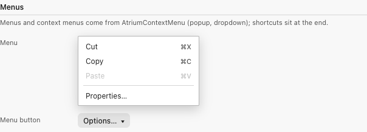

- **Use** `AtriumContextMenu.popup` for context menus and `AtriumNavCommon.actionMenu(trigger, commands)` for a "⋯" or "Options…" button. Commands are `{label, run, enabled, shortcut, checked, sub}`, and `"-"` is a separator. The menu bar uses `.work-menu > .menu-items`.
- **Header triggers** `.ui-chrome-action[data-hover=raised]` shares the menu bar hover and open faces. A button-only export list uses `.ui-menu-buttons`. Use `.ui-menu-picks` for browsable native command buttons with a preview selection. A native group disclosure can use `.ui-chrome-action-compact` for its radius and `data-fill="soft"` for the group header.
- **Selection face** the library styles the active choice in a menu bar or context menu. A menu with custom placement such as Visual Diff uses `.ui-menu-item` for the same highlight.
- **States** hover and keyboard (selection fill), disabled (faint), checked (✓), submenu (›). Shortcuts sit at the end and are drawn by `AtriumShortcut`.
- **Don't** let the web view's own context menu appear. `workbench.js` cancels it.

<a id="popover"></a>
### Popovers, tooltips and hover cards

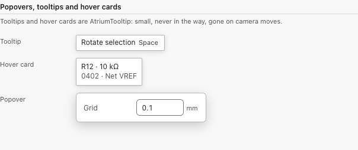

- **Tooltips** set `title` or `data-tooltip`, with `data-tooltip-shortcut` for a key. The tooltip does not appear while the control's own label is fully visible.
- **Hover cards** (canvas objects) are `AtriumTooltip` cards. They are small, they never block the object under the pointer, they close when the camera moves and they never appear on touch.
- **Problem cards** (problem markers on sheets and boards, `app/problem-hover.js`) are the same `.ui-tooltip.is-card` face with a heading (`.ui-tooltip-head`: a severity `.ui-dot`, the title in `strong`, the severity in `.ui-tooltip-meta`), a detail line, a short `.ui-tooltip-list` for a marker that stands for several problems (`data-wide` lets it grow to 380 px; each row keeps its title and `.ui-tooltip-value` whole on line 1 and wraps the rest to two lines at most), and `.ui-tooltip-actions` with small quiet buttons. `data-interactive` lets the pointer reach the buttons; the card still never takes the focus. They show after a 350 ms rest, sit beside the marker and its objects (never over them) and close on pointer leave, camera change, Escape, a press elsewhere, an edit, and during drags, routes and placement. On touch a tap on a marker shows the card.
- **Popovers** are `.ui-popover`, a small floating form anchored to a button with `--overlay`, `--r-lg` and `--elev-2`. Close it with Escape and with a click outside it.

<a id="dialog"></a>
### Dialogs and sheets

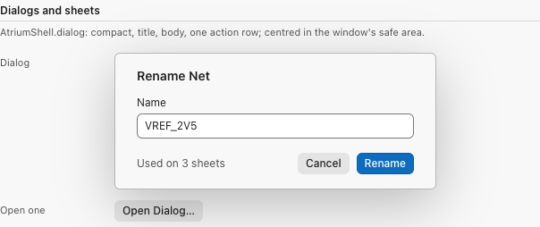

- **Use** `AtriumShell.dialog({title, body, actions, sheet})` for a new prompt. Use `adoptDialog` or `openDialog` for existing markup ([Dialog inventory](dialog-inventory.md)). Dialogs are compact rows in the Output Job style. A dialog's title does not repeat the command name, and it has no subtitle.
- **States** the default action (`data-ui-default`), a safe initial focus for destructive choices, a status line leading the action row (`.ui-dialog-status`) and sticky actions (`.ui-sticky-actions`). Dialogs centre in the safe area (`--dialog-safe-top`, `--dialog-avail-*`). Primary comes last on macOS and Linux and first on Windows.

### Window safe area

The macOS app draws the page under a transparent title bar. The window controls sit over the top-left of the page. The host publishes the band as `--macos-caption-height` and `--macos-caption-inset` (`native/macos/main.swift`). On Windows the page draws the title bar itself (`native/windows/window-caption.js`): the host removes the system caption, the window controls sit at the top right of the page, and the band is `--windows-caption-height` with `--windows-caption-right-inset` beside the controls. Detached windows load the same page and get the same values.

- `--window-caption-height` is the height of that band (0 in a browser). Only title-bar rows draw in it: the app bar and `.ui-fullwindow-bar`. Their content starts after `--macos-caption-inset` and ends before `--windows-caption-right-inset`.
- **The blank caption** is the app bar's `[data-caption-drag]` spacer. It moves the window on both platforms; keep it in the app bar's leading row.
- **Full-window surfaces** (the component gallery) use `.ui-fullwindow` for the surface and `.ui-fullwindow-bar` for its top bar. The bar takes the app bar's caption insets and height. Use it instead of `position:fixed; inset:0`. Set `--ui-bar-inset` and `--ui-bar-height` if the bar's own padding or height differs from a toolbar's.
- **Everything else pinned to the top** (banners, floating panels, notices) starts at `var(--window-safe-top)`, which is below the title bar and the app bar. Modal dialogs use `--dialog-safe-top`.
- **Script-placed popovers** (menus, hover cards, tooltips, select lists, floating panels) clamp their top edge to `--window-caption-height` plus their margin, never to 0.
- **Checks.** `tests/ui-library-lint.py` (titlebar) fails a fixed rule pinned to the top without these. `tests/browser-titlebar-safe-area.cjs` simulates the title bar (`--windows` for the Windows caption), opens every action, menu and context menu, and fails if anything other than a title-bar row draws in the band, or if anything at all covers the window controls. `tests/editor/browser-windows-caption.cjs` checks the Windows caption's controls, moving, resizing and window menu.

<a id="toast"></a>
### Toasts and status lines

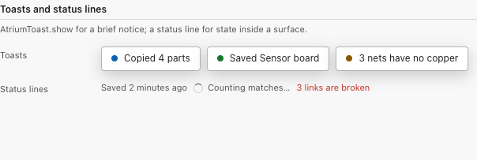

- **Toasts** `AtriumToast.show(text, {kind:"info"|"ok"|"warn"|"error"})` give brief feedback after an action. One toast (`.ui-toast`) shows at a time. It never takes focus and pauses while the window is hidden. Its kind shows as a status dot, as on a notice (info, success, warning, danger). There is no coloured edge.
- **Status lines** `.ui-status-line` (`K.statusLine(text, {tone, busy})`) show one muted line of state inside a surface, such as counts, "Counting matches…" or "Saved 2 minutes ago". The window status bar is `.statusbar`.

<a id="notice"></a>
### Notices

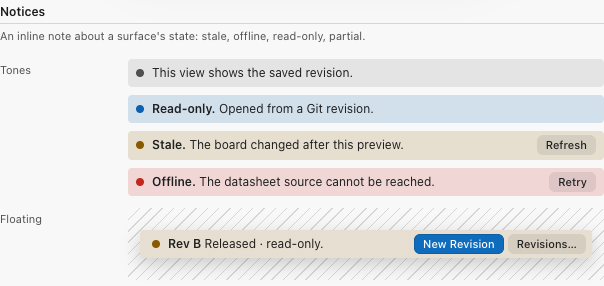

- **Use** to show a surface's state at the top of that surface: stale, offline, read-only, partial, denied, or waiting for consent.
- **Markup** `.ui-notice[data-tone]` with `.ui-dot`, `.ui-notice-text` (`.ui-notice-title` and text) and `.ui-notice-actions`. `K.notice({tone, title, text, actions, live})`.
- **Floating** `data-floating` (`K.notice({floating:true})`) is a banner over the canvas, such as the read-only revision banner or the recovery warning. It lays the tone's tint over a solid `--surface` at `--elev-2`, so the drawing never shows through. The feature places it (`position:fixed`, its inset and layer) and keeps no face of its own.
- **Don't** add a border or stack notices. Use one notice per surface and put the most severe state first.

<a id="empty"></a>
### Empty states

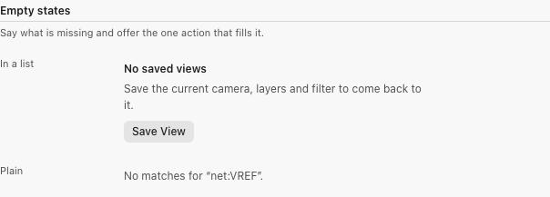

- **Use** when a list, panel or result has nothing to show. Say what is missing, why, and offer the one action that fills it.
- **Markup** `.ui-empty` with an optional `.ui-empty-title`, `<p>` and `.ui-empty-actions`. `K.empty({title, text, actions, centred})`. Keep an empty authored value separate from a query that returned no rows.
- **Tokens** `--muted`, `--fs-12`, `--lh-loose`. Older module classes (`*-empty`) share the face through the list in `polish.css`.

<a id="progress"></a>
### Progress and spinners

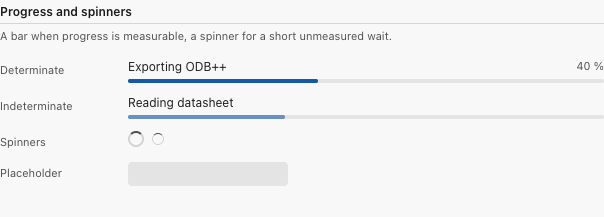

- **Use** a bar when progress can be measured, such as an export, a transfer or a check. Use a spinner for a short wait that cannot be measured, and `.ui-skeleton` in place of a page or thumbnail that is still rendering.
- **Markup** `.ui-progress[role=progressbar]` with `--ui-progress` (0–1) or `data-indeterminate`, usually inside `.ui-progress-row` with a label and value. `K.progress({value, label})` returns a node with `.set(value, text)`. Use `.ui-spinner` (`K.spinner()`) and `.ui-skeleton`.
- **Motion** loading indicators are the one exception to the [300 ms rule](motion.md): the spinner turns and the indeterminate bar sweeps until the wait ends. With Reduced motion they stay still (a still arc and a still third), and Off stops them. `tests/motion.cjs` allows a loop only on these two. Show elapsed or remaining text when a wait is long.

<a id="thumb"></a>
### Thumbnails

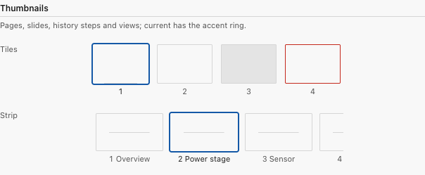

Print and report previews share `.ui-page-art`. Page tiles keep their lighter paper shadow and `.ui-page-zoom` gives the enlarged page its original deeper shadow.

- **Use** for PDF pages, slides, history steps and saved views. Render only the visible thumbnails.
- **Markup** `.ui-thumbs` grid of `.ui-thumb` (`.ui-thumb-art` around an img or canvas, `.ui-thumb-label`). `aria-current` gives the accent outline, `data-state="pending"` shows a placeholder fill and `data-state="failed"` gives an error outline. `K.thumb({label, art, current, state, run})`.
- **Strip** (proposed component, 2026-11-23) `data-strip` on `.ui-thumbs` makes one scrolling line: a column for a side rail (PDF pages, slides), `data-strip="row"` for a filmstrip. `--ui-thumb-size` and `--ui-thumb-ratio` size the tiles. The datasheet reader, the slide deck and the saved views use this one strip. Render art only for tiles in view, and keep the current tile in view while stepping.

<a id="pager"></a>
### Pagers

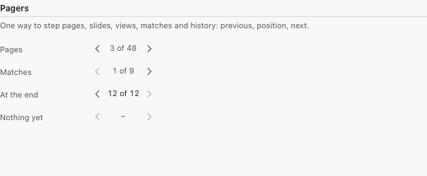

- **Use** (proposed component, 2026-11-23) wherever the user steps through an ordered set: PDF pages, search matches, slides, saved views in a presentation and history steps. It is the one stepping control, so these surfaces behave alike.
- **Markup** `.ui-pager[role=group]` containing a previous `.ui-icon-button`, `output.ui-pager-position` ("3 of 12") and a next `.ui-icon-button`. `K.pager({index, count, unit, label, onStep})` returns the group with `.set(index, count, text)`; `onStep(delta)` gets ±1, or ±Infinity for Home and End.
- **States** both ends disable their button; `data-state="end"` inks the position on the last item; no items shows "–" with both buttons disabled. ←/→ and Page Up/Page Down step while focus is in the group (mirrored in RTL).
- **Tokens** `--muted`, `--fs-11`, tabular figures; the buttons are small icon buttons.

<a id="commit-graph"></a>
### Commit graph

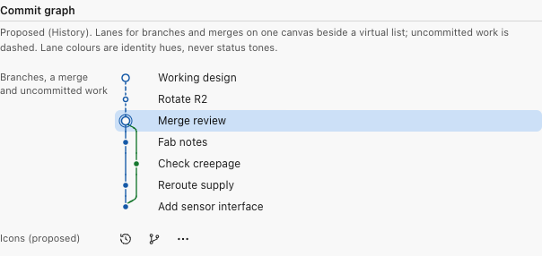

- **Use** (proposed component, 2026-11-23) beside a history list: branches and merges as lanes, uncommitted work as a dashed lane into the current commit. Project History is its first user. It replaces the per-row SVG cells of the Git picker and Project History when approved.
- **Markup** one `<canvas aria-hidden="true">` over the leading edge of a virtual `.ui-list`, with each row padded by the graph's width. [`ui/commit-graph.js`](../app/ui/commit-graph.js) (lazy, `AtriumCommitGraph`): `lanes(commits)` assigns lanes (pseudo entries are dashed), `width(rows)` sizes the column, and `paint(canvas, {rows, first, last, top, rowHeight, width, height, nodes})` draws only the rows in view. Rows stay real `.ui-row`s, so selection, hover and focus are the library's.
- **Nodes** `commit` (solid; hollow when the commit changed nothing in the design), `merge` (a ring), `working` (an accent ring), `step` (a small dot for an undo step or a snapshot); `current` adds a halo (HEAD, or unsaved work).
- **Tokens** lane 0 is `--accent`; further lanes take the avatar identity hues `--success`, `--insight`, `--info` and then `--muted` (green and violet first, so a second lane never reads as the first in a blue-accent theme). Lanes are identities, so `--warning` and `--danger` are never lane colours. Edges are 1.5 px, nodes 3.5 px, with a `--surface` rim.
- **Icons** (proposed with it) `history` (a clock with a return arrow), `branch` and `more` (⋯), added to the icon bank by `AtriumCommitGraph.icons()` until approved for `index.html`.
- **Don't** draw a graph per row (cost grows with rows), or colour a lane by status.

<a id="steps"></a>
### Steps

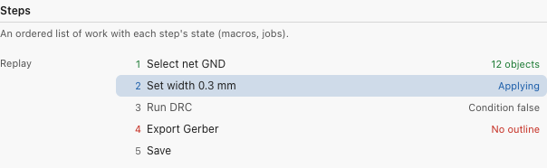

- **Use** for an ordered list of work, such as macro steps, job stages or replay.
- **Markup** `ol.ui-steps > li.ui-step[data-state=pending|running|done|skipped|failed]` with a title and a `.ui-step-result`. `K.steps(items)`.

<a id="diff"></a>
### Before and after

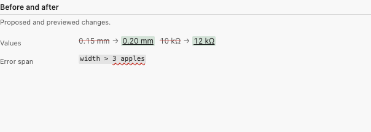

- **Use** for proposed edits (AI, macros), previews and compare views. `.ui-diff` contains `del.ui-diff-before`, an arrow and `ins.ui-diff-after`. `K.diff(before, after)`. Use `.ui-error-span` for a located error in query or formula text, and `.ui-code` for inline source.

<a id="transcript"></a>
### Transcript

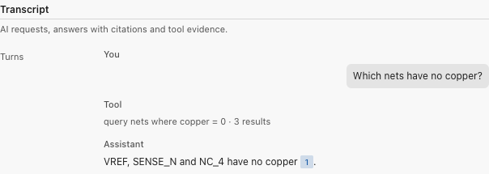

- **Use** for AI requests and answers. `.ui-transcript` contains `.ui-turn[data-role=user|assistant|tool]`. The answer text is selectable. `.ui-cite` is a numbered citation button that opens the source. Tool evidence goes in a muted `tool` turn. `K.turn(role, body)`, `K.cite(n, {run})`.

<a id="recording"></a>
### Recording indicator

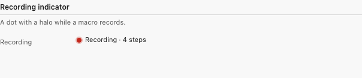

- **Use** while a macro or capture records. `.ui-recording` contains a danger `.ui-dot` with a halo and a short state, such as "Recording · 4 steps". `K.recording(text)`. Put it in the status bar.

<a id="viewport"></a>
### Design viewport

- `.ui-viewport` fills the editor surface and keeps gestures in the canvas. Use `data-interaction="design"` for a drawing canvas or `data-interaction="orbit"` for an absolutely positioned orbit surface in `.ui-viewport-layer`.
- The active and orbit toolbars share `.ui-canvas-tools`. The center and right placements keep their original shadows and button states.
- The orbit surface and the 2D pan tool share the grab and grabbing cursors. Tool mode and drag thresholds stay with each editor.

<a id="splitter"></a>
### Splitters

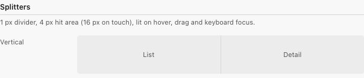

- **Markup** `.ui-splitter[role=separator][aria-orientation]`, which is 1 px wide with a 4 px hit area (16 px on touch). It lights `--focus` on hover, during a drag and for keyboard focus. `K.splitter({orientation, onResize})` handles pointer and arrow keys. Dock sashes (`dock.css`) are a settled surface with the same behaviour.

<a id="drag"></a>
### Drag handles and drop targets

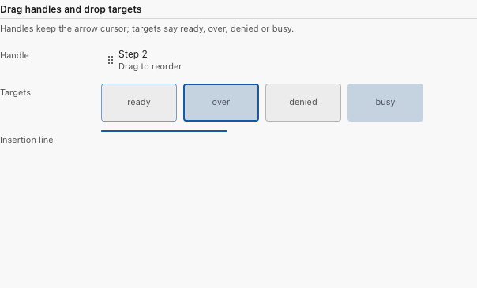

- **Handles** `.ui-drag-handle` shows six dots and keeps the arrow cursor. Do not use a grab hand on chrome. Lifted rows use `ui/spatial-motion` (`.ui-drag-lift`).
- **Targets** `.ui-drop-target[data-drop=ready|over|denied|busy]` (`K.dropState(node, state)`) draws an inset ring and a tint above the content. Cells and geometry stay readable. Put a denied target's reason in the status line. `.ui-drop-line` marks an insertion point.

<a id="panel"></a>
### Panels and list-detail

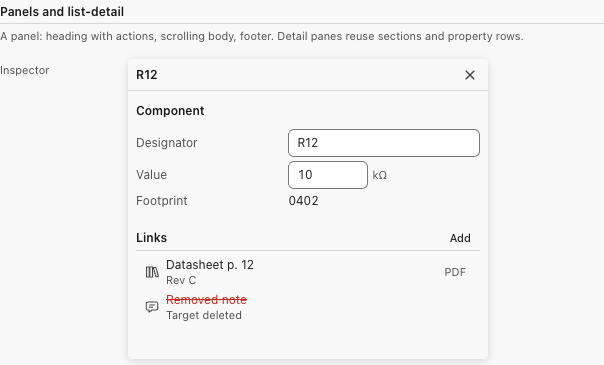

- **Markup** `.ui-panel` contains `.ui-panel-head` (`.ui-panel-title` and actions), `.ui-panel-body` (scrolls, `overscroll-behavior:contain`) and `.ui-panel-foot`. For a list-detail view, use `.ui-split` (list, `.ui-splitter`, detail). `K.panel({title, actions, body, foot})`. Dock panels keep the dock's `.pane-heading`. An overlay pane uses `.ui-drawer` and its responsive layout sets `--ui-drawer-shadow` to `--elev-workspace-drawer` or `--elev-sheet-drawer` while it overlays the content.

## Composition guide

Build modern, sleek surfaces with the rules above. These are the house conventions.

**Spacing rhythm.** Use the 4 px grid (`--s-*`). Put 4 px between related controls in one group, 8 px between controls in a row, 12 px between sections in a panel, 16 px of panel and dialog padding (24 px inline in dialogs), and 24 px between major regions. Do not mix values off the scale.

**Hierarchy.** A surface has one title (`--fs-14` semibold in dialogs, `--fs-12` semibold in panels). Sections use semibold `--fs-12` headings. Body text is `--fs-12` and secondary text is `--muted` `--fs-11`. Use weight and colour for emphasis, not size. Put a group's actions on its heading row, use hairlines (`--line`) rather than boxes, and use one primary action for each surface.

**Density.** Desktop rows are 24 px (`--chrome-row-height`), controls are 24 px (`--ctl-h`), fields are 28 px and chips are 22 px. On touch, hit areas grow (`--ctl-h-touch` 44 px), but painted chrome stays on the same grid. Prefer compact rows, as in Altium's Output Job dialog, to cards. Tables use tabular figures.

**Motion.** Use the tokens only ([Motion](design-system.md#motion)). Use `--motion-instant` for hover, press and hover-triggered reveals. Use `--motion-fast` for other reveals, indicators and popovers, and `--motion-base` for panels and dialogs. Animate opacity and transform. Exits are faster than entrances, and an animation never holds input. Reduced keeps fades and removes movement. Off is instant.

Hover keeps the resting border colour across the app. The UI library lint checks authored stylesheets for hover border changes and timing. Its reviewed exception is the layer colour swatch, whose fill represents the exact authored colour.

**Building a panel.** `K.panel({title, actions})`. Put a toolbar or search under the heading only when the list needs one. The body is a `.ui-list` of `.ui-row` or a set of `.ui-section`s. Put state in a `.ui-notice` at the top (stale, offline, read-only) and counts in a `.ui-status-line` or the footer.

**Building an inspector.** Use one `.ui-section` for each group, with `data-quiet` when property rows follow. The docked Inspector shares the section heading layout with the full-width divider used by `.ui-section-head[data-bleed]`. Make each value a `.ui-prop-row`. Edits apply on Enter or blur as one undo step. Show an error under its value with `.ui-prop-error`. Put Add actions as icon buttons on the section heading. Show linked items as `.ui-row`s inside the section, not as cards.

**Lists in lazy modules without eager bytes.** A list needs no builder. Its markup is the contract, and `components.css` is eager: `<div class="ui-list" role="listbox">` with `<div class="ui-row" role="option" aria-selected>` rows (`.ui-row-icon`, `.ui-row-text` > `.ui-row-title` + `.ui-row-detail`, `.ui-row-meta`, `.ui-row-actions`). A lazy module may also `await AtriumLazy.need("AtriumUIKit")` in its own code, which costs no eager bytes. Do not add the kit to a module's `deps` in `lazy.js`, because `lazy.js` is eager. The kit is prefetched at idle, so `globalThis.AtriumUIKit` is usually there already. A list declared in HTML keeps its role and accessible name before the lazy renderer arrives. The renderer supplies the `.ui-row` options. Keyboard movement and the active row stay with the feature.

**Building a list-detail view.** Use `.ui-split`: the list on the inline start (`.ui-list`, selection by stable ID, keyboard arrows), a `.ui-splitter`, and the detail as an inspector. With nothing selected, the detail shows `.ui-empty`. With several items selected, it shows the shared properties and a count.

**Empty state.** Use one sentence for what is missing and why, and one action that fills it. Use a title only when the whole panel is empty. Keep "nothing authored" separate from "nothing matched" and from "not available" (offline, denied), which is a `.ui-notice`.

**Progress or a long-running job.** Under 1 s, show nothing. From 1 to 3 s, show a `.ui-spinner` in the surface's status line. Longer or measurable work gets a `.ui-progress-row` with a label, a value and a Cancel button (quiet). The editor stays usable while the job runs. When the job finishes, replace the bar with the result, such as a receipt row, warnings as a `.ui-notice` or a toast if the surface has closed. Partial results keep the last good rows and mark what is missing.

## Migrating a family

1. Run `node tests/browser-ui-snapshots.cjs --app <base>/app --out /tmp/before` on the base commit.
2. Replace the feature's class with the library class in its JS. Delete the feature CSS that drew the face, and keep only placement.
3. Run `node tests/browser-ui-snapshots.cjs --out /tmp/after --compare /tmp/before`. A settled surface must match pixel for pixel and style for style. A difference you intend needs the user's approval. Pass it with `--allow <surface>` and record it in the commit.
4. Run `python3 scripts/ui-inventory.py --write`, then remove the class from the lint allow-list.

## Migrated in this pass

| Family | Change | Evidence |
| --- | --- | --- |
| Close buttons | Fifteen feature close buttons now use `.ui-close`: BOM, Constraints, Find and Replace, Library dialog and panel, Nets, Messages, PCB List, Navigator, Filter, Scripting, View Configuration, Selection Memory, Minimap, Variants, Clipboard and History. The shared rule moved from `polish.css` and `ui/history-close.css` into `ui/components.css`. The feature classes keep only placement. | `tests/browser-ui-snapshots.cjs`: identical pixels and computed styles on every surface in light, dark and touch. |
| Chips | The Properties Selection Filter, the settled chip face, now uses `.ui-chip`. Its private rules in `pcb-edit.css` are gone. | Identical pixels and computed styles on the PCB and schematic editors in light, dark and touch. `browser-editor-chrome.js` passes. |
| Editor chips, badges and close buttons | Decision 3: the PCB multi-selection kind chips, Signals kinds, tags and parts, naming chips, key-binding chips and generic-part gates are `.ui-chip`. Decision 4: Constraint Manager Pass/Fail, naming status, the default-stack note, via-stack defaults, stale via fences, the DRC Fix tag, pour states and the problem inspector's severity are `.ui-badge`. The problem inspector, Insights card, MCAD panel and placement hint close with `.ui-close`, and the inspector's arrows are `.ui-icon-button`. | Snapshots: the PCB editor, Constraints and Nets change only where a decision applies. |
| Editor search fields | Decision 7: Nets, Messages, Navigator, Constraint Manager, Online DRC, the rule editor's finders, Signals, Keyboard Shortcuts, the swap picker and the calculation sheet's reference finder are static `.ui-search` markup that `AtriumUIKit.adoptSearch` completes. | Snapshots: Nets, Messages, Navigator and Constraints gain only the magnifier. |
| Editor rows, notices, fields and empty states | Decision 8: the autorouter's unrouted list and the swap picker are `.ui-row`s; the drawing check and approximate rule sets are `.ui-notice`; drawing inspector fields are `.ui-field`; eight editor empty states are `.ui-empty`. | Surfaces outside the snapshot suite. |

| Toasts | `AtriumToast` draws `.ui-toast` (moved from `nav.css` into `ui/components.css`). Its kind is a status dot, and the coloured left stripe is gone (decision 2). | Gallery and toast captures in light, dark and touch: only the stripe and the dot differ. |
| Loaders | `.ui-spinner` turns and the indeterminate `.ui-progress` sweeps, and both hold still under reduced motion (decision 1). The status bar's opening progress is now `.ui-progress` (`editor-files.js`). | Reduced-motion captures are unchanged. The status bar track now uses the library's soft fill instead of `--line-strong`. |
| Icon buttons | `.tool` is 24 px with the control radius (decision 5). The Library dialog's close button and the extension panel's close button are `.ui-icon-button`. | The Library close button is unchanged (23 × 23, 6 px radius). |
| Search fields | The Library dialog's search and the Change table's search are `.ui-search`. The kit adopts static `.ui-search > input` markup on focus, adding the clear button, the count and Escape. The Change table counts its matches (decision 7). | The Library dialog's magnifier moves inside the field, and a clear button appears once there is text. |
| Badges | The Change table's severity labels (`.rev-sev`) are `.ui-badge` (danger for electrical, warning for layout, neutral for cosmetic) (decision 4). Its export buttons lose their grey outline and take the soft-fill `.ui-button` face. | Not covered by the snapshot surfaces. The Change table needs a Git history. |
| Project chips | `.bom-chip`, the BOM hint chip, `.lib-chip` (Library panel filters, symbol and gate toggles), `.eco-chip`, the Visual Diff severity and change-type filters, the Review Changes filters and the collaboration peer chips are `.ui-chip` (decision 3). A status that the old tint carried is a `.ui-dot` inside the chip. Small actions that were drawn as chips are small `.ui-button`s. | Project surfaces in light, dark and touch: only chip faces changed. |
| Project badges | `.ext-chip`, `.ext-pill`, the Developer and Installed badges, `.gp-chip`, `.mg-chip`, `.revisions-chip`, `.bom-badge`, `.bomopt-tag`, the `.lib-badge` state marks, `.cat-tag`, `.eco-badge-*`, `.rel-chip`, `.rc-badge`, `.clip-badge` and the start page's recent-project badge are `.ui-badge` with a tone (decision 4). `.cat-badge`, `.dv-badge` and the Library panel's placement and issue counts are `.ui-count`. | Only the badge faces changed: no outline, 16 px, status ink on its tint. |
| Project search fields | Preferences, the start page, Clipboard History, the Git picker, Visual Diff, the Library panel, BOM, Variants, ECO, Review comments, the theme editor and the shortcuts sheet use `.ui-search`; the kit adopts them. Clipboard History, Visual Diff and the theme editor count their matches (decision 7). | The private search boxes (`.prf-search-box`, `.sp-filter`) lose their own face. |
| Clipboard buttons | Clipboard History's Pinned filter and Paste are small soft-fill `.ui-button`s (decision 6). | The grey outline is gone. |
| Project progress | The welcome checklist meter and the Visual Diff comparison bar are `.ui-progress`. | The bar no longer eases between values. |
| Switcher | The Ctrl+Tab document switcher is a `.ui-popover` (`--elev-2`, was `--elev-3`) with `.ui-row` options. The welcome page's selects are `.ui-field`. | Rows family (decision 8). |
| Fab tab strip | Fabrication Outputs' view tabs use the library strip (`.ui-tabs[data-strip]`); `.fab-tabs` keeps only its margin. | The strip gains the `--panel-head` band. |
| Second decisions (2026-11-23) | 1: the read-only revision banner and the recovery storage warning are `.ui-notice[data-floating]`; the dead compatibility banner rules are gone. 2: presence badges and extension monograms are `.ui-avatar`; the template layer count is `.ui-overlay-label`. 3: `.ui-icon-button` draws in `--ink`; the Projects actions and Clipboard History's item buttons are `.ui-icon-button`. 4: net, layer, theme, logo, welcome, VS Code import, rich-text and table colours set `--swatch` (cell borders `--swatch-<edge>`); the lint accepts `var(--swatch)` and now also catches `.style.setProperty` faces. 5: `.tool` hovers with `--button-face-hover`. 8: the Nets, Navigator and Signals counts are in their search fields. | Before and after captures in light, dark and touch for each surface. Only the faces the decisions name changed; a docked Nets or Signals heading that held only its title and close button now hides under the dock tab. |
| Editor strips, lists and completions | The Board Shape, Layer Stack, Signal Integrity, Signals, via fence and View Configuration switchers are `.ui-tabs[data-strip]`. The autorouter strategies are `.ui-row[aria-checked]` radios. Fourteen selection lists (component classes, swap picker, part matches, placeholder candidates, layer sets, pours, board and library rule sets, rule classes, impedance profiles, via templates) follow the lazy-list markup contract, and the math, design-field and package suggestions are `.ui-select-list[data-completion]`. `tests/ui-library-lint.py` now accepts a listbox built on that contract and self-tests both kinds. | Snapshots: View Configuration and Rule Sets change only in the strip and list faces. |
| Messages face (2026-11-23) | The Problems domain filters (Schematic, Layout, Fab sign-off, Waived) are `.ui-chip` toggles. The view tabs, the class counters, the time and number columns and the net-pair rows use the UI font (`--font-ui`, tabular figures for numbers) instead of the monospace face, so every source's rows and the panel's head read in one face. | `tests/browser-messages-fonts.js`: one family in the panel; one message, detail and number font across sources. Captures in light, dark and touch. |

## Still to migrate

These sites still draw their own face. They differ from the settled face, so moving them would change how they look and needs the user's approval. The [UI inventory](ui-inventory.md) lists every class.

| Family | Sites | Difference from the library |
| --- | --- | --- |
| Chips | `.nav-palette-scope-chip`, `.query-chip`, `.thp-chip` (a colour swatch, not a chip), and others | Many are pills (`--r-pill`), several use accent or tint fills when on (`--tint-accent`, `--selection` with an accent border), and heights vary from 16 to 24 px. |
| Avatars and overlay labels | The collaboration roster and toolbar faces (`.collab-face`, `#collab-more`, 24 px with a `currentColor` border) and Clipboard History's kind label (`.clip-kind`, over the thumbnail) | Same families as `.ui-avatar` and `.ui-overlay-label`, but not named in the 2026-11-23 decisions (proposal). |
| Icon buttons | `.dv-tool`, `.fe-tool` | Their own sizes and radii; `.ui-icon-button` is 24 px with a 6 px radius. |
| Empty states | 14 module `*-empty` classes listed in `polish.css`, plus about 20 more (`inventory`) with their own margins | Margins and font sizes (11 or 12 px) differ. New code uses `.ui-empty`. |
| Search fields | `.sheet-overview-search`, `.symbol-search`; the Board Revisions change search (`.rev-controls`, placed by `workflows.css`) | Without the library field: no clear button or match count. |
| Progress | `.tut-meter` | Radius and track colour differ from `.ui-progress`. |
| Section headers | 55 `*-head`/`*-heading` classes | Sizes and weights vary. Some sit in bordered boxes. |
| List rows | 67 `*-row`/`*-item` classes. The Projects tree (`style.css`) and Library rows (`.lib-row`) are settled. | Heights (22–28 px), selection fills and hover rules vary. |
| Data swatches | Datasheet display and worker sources | The lint checks the authored `.mjs` inputs and verifies the generated, ignored `datasheet-worker-source.js` bundle. PDF.js annotation colours stay in the pinned vendor source. |
| Notices | `.lib-notice`, `.fab-alert` | Inline notices with borders and different paddings. (`.about-notice` is the About dialog's legal disclaimer paragraph, not a state notice, so it stays text.) |
| Editable grids | `.cm-cell`, `.cm-editor`, `.rules-matrix input.is-set`, `.sw-grid` inputs, `.erc-matrix` buttons, `.erc-level` selects | Cell editors and the ERC matrix. `ui/spreadsheet.css` does not cover them yet. The ERC severity colours are theme tokens (`--erc-*`), not data, so they stay in CSS rather than `--swatch`. |

## Settled faces

The user kept these appearances on 2026-11-23. Their shared library recipes preserve the established geometry and interaction. The UI lint tracks any explicit exceptions in `tests/maintenance/ui-library-legacy.json`.

| Surface | Sites | Settled behavior |
| --- | --- | --- |
| Editor chrome | Dock tabs and their close (`.dock-tabs`, `.dock-tab-close`), pane tabs and their close (`.pane-tabs`, `.pane-close`), the split button (`.split-button`), the view-tab close (`.view-tab-close`), the layer tab's drawing mark (`.layer-tab.is-drawing`) | Settled chrome, covered by `browser-chrome-pixels.js`; 20 px close buttons with a 2 px radius. |
| Tool bars on content | The 3D view bar's buttons (`.v3d-btn`) and the rich-text tool buttons (`.rn-tools`) | Text and tool buttons drawn over the 3D view and over a text frame. |
| Boxed tab strips | Constraint Manager's `.cm-tabs` and the BOM's `.bom-tabs` | Boxed strips in settled dialogs. New tab strips use `.ui-tabs[data-strip]`. |
| Class selects | The Nets panel's class select (`.nets-tools select`) and the PCB List's selects (`.pl-head select`) | Compact selects in dense panel toolbars. |
| Change table rows | The Board Revisions change table's rows | 38 px rows with two lines (the object and its change), not 24 px `.ui-row`s. |
